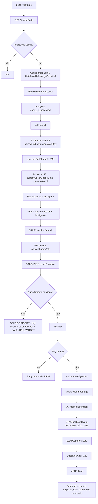

# Link Curto — Pipeline completo do primeiro clique à resposta final

> Documento de investigação estática do comportamento encontrado no código. Não corrige nem altera lógica de produção.

## Evidências principais

| Área | Arquivos/funções |
|---|---|
| Link curto | `server.js` — `GET /l/:shortCode`, `POST /api/create-short-url` |
| Chatbot | `server.js` — `GET /chatbot`, `generateFullChatbotHTML()` |
| Cliente do chat | JavaScript inline gerado por `generateFullChatbotHTML()` |
| IA principal | `server.js` — `POST /api/process-chat-inteligente` |
| Jornada/inteligências | `lib/ai-systems/journey-analyzer.js` |
| Agendamento | `superInteligencia.detectarAgendamento()` e `schedulingManager` |
| V17 | `lib/v17-orchestrator.js` |
| V18 | `lib/v18-extraction-guard.js` |
| V19 | `lib/v19-deterministic-engine.js` |
| Captura | `lib/lead-capture-score.js` |

## 1. Entrada do usuário

### URL acessada e Link Curto

O primeiro clique do visitante normalmente chega em `GET /l/:shortCode`. A rota valida o `shortCode` com `ShortUrlGenerator.isValid`, tenta recuperar o registro em cache (`short_url:<shortCode>`) e, se não houver cache, busca no banco via `DatabaseHelpers.getShortUrl(shortCode)`. Se o código é inválido ou inexistente, retorna `404`.

Depois da resolução, a rota atualiza acesso de forma assíncrona, registra analytics `short_url_accessed`, carrega whitelabel e monta uma query string para `/chatbot` com:

```text
name=<robot_name>
url=<sales_url>
instructions=<instructions>
apiKey=<api_key>
wlCompany=<whitelabel.companyName>
wlLogo=<whitelabel.logoUrl>
wlPrimary=<whitelabel.primaryColor>
```

Por fim, faz `res.redirect('/chatbot?...')`.

### Criação da Short URL

`POST /api/create-short-url` recebe `{ robotName, salesUrl, instructions, apiKey }`, exige `apiKey`, aplica limites de assinatura quando disponíveis, gera `shortCode` único, persiste em `short_urls`, grava cache e retorna `shortUrl = <protocol>://<host>/l/<shortCode>`.

### API Key e resolução do tenant

No fluxo do link curto, o tenant é a própria `api_key` armazenada no registro `short_urls`. Essa chave passa para `/chatbot` como `apiKey` e depois é injetada no HTML em `currentApiKey`. No endpoint principal, `apiKey` é obtida do body/query/session/middleware e usada como identificador de tenant para billing, captura, scheduling, analytics, checkout, whitelabel e lead systems.

## 2. Geração do Chat

### `/chatbot`

A rota `/chatbot` lê query params (`name`/`robotName`, `url`, `instructions`, `apiKey`, whitelabel), coleta/usa `pageData` e retorna HTML gerado por `generateFullChatbotHTML(pageData, robotName, instructions, ...)`.

### `generateFullChatbotHTML()`

A função gera um documento HTML completo com:

- estilos do chat e tela de aquecimento;
- formulário inicial opcional de lead;
- área de mensagens;
- input e botão enviar;
- widgets inline de captura;
- widget de calendário quando a resposta contém `[CALENDAR_WIDGET]`;
- JavaScript bootstrap com `currentApiKey`, `pageData`, `robotName`, instruções e funções de envio.

### Widgets envolvidos

1. **Warming screen**: tela inicial com CTA “Iniciar Conversa”.
2. **Lead form inicial**: formulário antes do chat quando habilitado.
3. **Chat messages**: renderização de mensagens usuário/bot.
4. **Inline lead capture**: formulário inserido durante a conversa se backend retorna `leadCapture.shouldCapture`.
5. **Calendar widget**: renderizado quando resposta contém `[CALENDAR_WIDGET]` e usa `/api/availability?apiKey=<currentApiKey>`.
6. **CTA link buttons/tracking**: URLs em respostas viram botões e disparam tracking de clique.

### Bootstrap da conversa

O JavaScript inline inicializa variáveis de sessão no navegador, exibe tela de aquecimento, renderiza mensagens e envia o payload para `/api/process-chat-inteligente`. O `currentApiKey` é interpolado no HTML a partir da query/tenant.

## 3. Inicialização da Sessão

### Identificadores

- `conversationId`: criado no frontend como identificador de conversa/sessão (`chatbot_...` ou variável equivalente `sessionConversationId`) e enviado a cada mensagem.
- `leadId`: começa `null`; é preenchido após `/api/capture-lead` retornar `lead.id`.
- `sessionId`: no backend existe sessão Express; no frontend o identificador operacional usado pelo pipeline é o `conversationId`.

### Storage, cookies e persistência

- O chat gerado usa variáveis JavaScript em memória para `leadId`, `inlineCaptured`, seleção de calendário e `sessionConversationId`.
- Não foi identificado uso obrigatório de cookie no widget gerado para sustentar a conversa; a persistência de lead/conversa ocorre via chamadas HTTP.
- Ao capturar lead, o frontend chama `/api/capture-lead` e depois `/api/link-conversation` com mensagens anteriores, `leadId`, `conversationId` e `apiKey`.
- No backend, histórico conversacional é salvo para o pipeline legado/V14.1 e estados V16/V19 ficam em mapas em memória por `conversationId`.

## 4. Payload enviado para IA

O payload real enviado pelo frontend para `/api/process-chat-inteligente` contém os campos centrais abaixo:

```json
{
  "message": "<texto digitado pelo visitante>",
  "pageData": { "...": "dados extraídos/configurados da página" },
  "robotName": "<nome do robô>",
  "instructions": "<instruções customizadas>",
  "apiKey": "<tenant api key>",
  "leadId": "<lead id ou null>",
  "conversationId": "<sessionConversationId>",
  "context": {
    "leadId": "<lead id ou null>",
    "conversationId": "<sessionConversationId>"
  }
}
```

Campos usados pelo backend incluem `message`, `pageData`, `robotName`, `instructions`, `apiKey`, `leadId`, `conversationId`, além de contexto derivado: `processedPageData`, `inteligencias`, `journeyStage`, `__v19Decision`, checkout, WhatsApp, histórico e flags.

## 5. Endpoint principal — `/api/process-chat-inteligente`

O endpoint é registrado com middlewares `requireApiKey` e `billingMiddleware` quando disponíveis. A ordem geral interna encontrada é:

1. Ler body e metadados (`message`, `pageData`, `robotName`, `instructions`, `apiKey`, `leadId`, `conversationId`).
2. Normalizar/enriquecer `processedPageData`.
3. Rodar V18 extraction guard, quando flag ativa.
4. Rodar V19 deterministic engine em modo `true` ou `shadow`, conforme flag/env.
5. Aplicar heurísticas V18.1/V18.2 de intenção/CTA quando V19 não está ativo.
6. Interceptar agendamento explícito antes de KB First (`SCHED-PRIORITY`).
7. Rodar KB First e possivelmente retornar resposta direta sem LLM.
8. Capturar inteligências e journey stage.
9. Montar contexto e chamar IA/resposta principal quando não houve bypass.
10. Aplicar pós-processadores: V18.3/V18.4, action resolver, checkout authority, limpeza, V11.3.3, PP global, V15, V19 apply/shadow.
11. Avaliar lead capture chat-first.
12. Retornar JSON final com resposta, campos de lead capture, calendário, CTA/metadados e observabilidade.

## 6. Pipeline de Inteligência — ordem real

A ordem real difere do exemplo linear porque há interceptações antecipadas:

```text
Entrada endpoint
→ Processamento/normalização pageData
→ V18 Extraction Guard (feature flag)
→ V19 decide (feature flag: active/shadow/off)
→ V18.1 força buy intent (se V19 inativo)
→ V18.2 força CTA (se V19 inativo)
→ SCHED-PRIORITY: detectarAgendamento() ANTES do KB First
   ↳ early return com [CALENDAR_WIDGET] + calendarHash
→ KB First
   ↳ early return se FAQ direta
→ capturarInteligencias()
→ analyzeJourneyStage()
→ fluxo de IA/resposta principal
→ V18.3 CTA final (se V19 inativo)
→ Action Resolver / state update
→ Checkout Authority hard override
→ Limpeza anti-spam
→ V11.3.3 orquestração final de vendas
→ PP Global (se V19 inativo)
→ V15 context enforcement
→ V19 applyDecision ou logDiff
→ Lead Capture Score
→ Observer/Audit V20
→ Response JSON
```

### Dependências e feature flags

- `FEATURE_V18_EXTRACTION_GUARD`: habilita guard de extração.
- `FEATURE_V18_FALLBACK`: permite fallback no guard V18.
- `FEATURE_DETERMINISTIC_V19`: controla V19 (`true`, `shadow`, ou desligado por env).
- Flags/env de chat-first controlam lead capture via score.
- Scheduling depende de `schedulingManager` e `apiKey` para `calendarHash`.

### Early returns encontrados

1. Short code inválido/não encontrado: 404 antes de `/chatbot`.
2. `SCHED-PRIORITY`: agendamento explícito retorna antes de KB First/IA.
3. KB First com FAQ direta retorna antes de agendamento legado/inteligências/IA.
4. Erros no endpoint retornam fallback JSON/erro.
5. V19 ativo não retorna cedo, mas bloqueia/evita pós-processadores legados em vários pontos.

## 7. Journey Stage

`analyzeJourneyStage(message)` calcula estágio por palavras-chave e retorna um objeto com estágio e metadados. Entradas: texto da mensagem. Saídas: estágio como descoberta/interesse/consideração/decisão/ação (nomes variam conforme implementação), confiança/sinais e recomendações. O endpoint chama essa análise depois das etapas de prioridade/KB e a usa no contexto de resposta, personalidade, auditoria e lead scoring.

## 8. Intent Detection

Há múltiplos classificadores:

1. `capturarInteligencias(mensagem)` detecta flags comerciais e operacionais como compra, preço, contato, site, bônus, experiência, suporte e saída.
2. `V17 detectIntent()` classifica intenções granulares (`buy`, `price`, `objection`, `support`, `exit`, `info`, `link_request` etc.) e define estratégia.
3. V18.1 força intenção de compra para palavras como “comprar”, “pagar”, “checkout”, quando V19 não está ativo.
4. V19 possui classificador determinístico próprio com estado conversacional e permite/bloqueia venda, CTA e checkout.
5. `decision-core`/V16 e pós-processadores também detectam suporte, pós-venda, checkout issue, objeção e saída.

A dependência crítica é que classificadores não são mutuamente exclusivos; o pipeline combina flags legadas, decisão V19, estado de conversa e disponibilidade de checkout.

## 9. Lead Capture

### Como decide

`lead-capture-score.evaluateCapture()` recebe `message`, `conversationId`, `inteligencias`, `journeyStage`, `hasCheckout`, `history` e `response`. Mantém sessão por conversa, soma sinais e retorna:

```json
{
  "shouldCapture": true,
  "score": 80,
  "signals": ["..."],
  "newSignals": ["..."],
  "captureMessage": "...",
  "captureContext": "..."
}
```

### Quando dispara

Dispara quando chat-first está habilitado, existe `conversationId`, o body ainda não tem `leadId`, o score/sinais atingem limiar, e a mensagem não é despedida. Sinais incluem intenção comercial, preço/compra, estágio avançado da jornada, resposta com checkout, engajamento e pedidos de contato.

### Quando não dispara / bloqueios

- Já existe `leadId` no body.
- Não há `conversationId`.
- Chat-first/score desabilitado.
- Conversa já foi tratada/capturada em memória.
- Mensagem é despedida/saída.
- Score abaixo do limiar.
- Erro no avaliador: fluxo segue com `{ shouldCapture: false }`.

## 10. CTA Engine

O CTA é composto por várias camadas:

1. `pageData.checkoutLink` vindo da extração/configuração.
2. V18 guard/fallback pode recuperar checkout ausente.
3. V17 monta estratégia e injeta link real quando intenção/estratégia permitem.
4. V18.2/V18.3/V18.4 forçam CTA para compra quando V19 não está ativo.
5. V19 decide `allowCTA`/`allowCheckout` e aplica checkout no final se ativo.
6. Checkout Authority/V11.3.3 fazem hard override e blindagem final.
7. Frontend transforma URLs em botões clicáveis e registra tracking.

Regras comerciais recorrentes: checkout não deve aparecer para suporte/saída/objeção sem intenção de compra; compra explícita deve receber link se houver checkout; self-reference e links bloqueados são filtrados; fallback pode usar WhatsApp quando não há checkout.

## 11. Scheduler

### `detectarAgendamento()`

O scheduler tem prioridade explícita: o endpoint chama `superInteligencia.detectarAgendamento(message)` antes do KB First. Isso foi criado para impedir que KB First capture frases como “quero agendar”. Quando detectado:

- gera resposta de agendamento;
- injeta marcador `[CALENDAR_WIDGET]`;
- gera `calendarHash` via `schedulingManager.generatePublicHash(apiKey)`;
- retorna JSON cedo, sem KB/IA.

### `calendarHash` e `sched-priority`

`calendarHash` é enviado para o frontend para renderizar/confirmar calendário público. O frontend também busca disponibilidade por `/api/availability?apiKey=<currentApiKey>`. Há uma proteção adicional que injeta `calendarHash` se o fluxo principal retornar uma resposta contendo `[CALENDAR_WIDGET]`.

### Retornos antecipados

O retorno antecipado principal é o path `SCHED-PRIORITY`, antes de KB First. No fluxo principal não há early return obrigatório, mas há enriquecimento da resposta com `calendarHash` se o marcador de calendário aparecer.

## 12. Response Builder

A resposta final é montada por camadas:

1. Base textual da IA/KB/scheduler.
2. Injeção/remoção de CTA por V17/V18/V19/V11/V15 conforme intenção e checkout.
3. Sanitização contra spam de CTA, links errados e contexto fraco.
4. Inserção de marcador `[CALENDAR_WIDGET]` quando agendamento.
5. Inclusão de objeto `leadCapture` para frontend abrir captura inline.
6. Inclusão de `calendarHash` quando necessário.
7. Logs/auditoria V20/WA parity/conversation logs.

O retorno JSON final inclui pelo menos resposta textual e metadados; no fluxo investigado aparecem `calendarHash`, `leadCapture`, estado/decisão V19 e flags observacionais.

## 13. Dependências ocultas e acoplamentos

- `apiKey` é tenant, credencial, chave de billing, chave de agendamento e chave de analytics ao mesmo tempo.
- `pageData.checkoutLink` é contrato implícito de várias versões (V17, V18, V19, V11, frontend CTA).
- O marcador textual `[CALENDAR_WIDGET]` acopla backend e frontend.
- `conversationId` controla estado em memória para V16/V19/lead capture.
- Short URL depende de cache, banco e whitelabel, mas falhas não são uniformes.
- Feature flags mudam profundamente o comportamento sem alterar payload público.
- KB First pode impedir IA e camadas posteriores.
- Scheduler foi movido antes de KB First por bug/regressão anterior.
- Frontend depende de nomes exatos (`leadCapture.shouldCapture`, `calendarHash`, URLs na resposta).

## 14. Fluxo visual



## 15. Pontos de regressão

### Top 20 riscos de regressão

1. Short URL não propagar `apiKey` para `/chatbot`.
2. Cache `short_url:<code>` stale após editar assistente.
3. `apiKey` ausente quebrar tenant, billing e scheduler.
4. Query params longos/truncados em `instructions`.
5. Whitelabel quebrar redirect por caracteres não escapados.
6. `conversationId` mudar a cada mensagem e perder estado.
7. `leadId` não ser enviado após captura, causando múltiplas capturas.
8. KB First interceptar agendamento.
9. Scheduler não retornar `calendarHash`.
10. Frontend não reconhecer `[CALENDAR_WIDGET]`.
11. V19 ativo bloquear pós-processadores legados esperados.
12. V19 shadow ser confundido com ativo.
13. V18 fallback sobrescrever checkout correto.
14. `pageData.checkoutLink` ausente impedir CTA.
15. CTA aparecer para suporte/saída.
16. Checkout ser self-reference para `/chatbot` ou domínio interno.
17. Captura disparar antes de gerar confiança.
18. Captura nunca disparar por falta de `conversationId`.
19. Sanitizadores removerem link correto.
20. Auditoria/observabilidade lançar erro e afetar resposta.

### Top 20 componentes críticos

1. `GET /l/:shortCode`.
2. `DatabaseHelpers.getShortUrl`.
3. `CacheManager` para short URLs.
4. `ShortUrlGenerator`.
5. `whitelabelManager`.
6. `GET /chatbot`.
7. `generateFullChatbotHTML()`.
8. JavaScript inline de envio do chat.
9. `/api/process-chat-inteligente`.
10. `requireApiKey`.
11. `billingMiddleware`.
12. V18 extraction guard.
13. V19 deterministic engine.
14. `superInteligencia.detectarAgendamento()`.
15. `knowledgeBase.searchSmart()` / KB First.
16. `capturarInteligencias()`.
17. `analyzeJourneyStage()`.
18. CTA/checkout authority layers.
19. `lead-capture-score.evaluateCapture()`.
20. `schedulingManager.generatePublicHash()`.

### Top 20 dependências ocultas

1. `apiKey` como tenant universal.
2. `short_urls.api_key` como fonte de tenant.
3. `pageData` como contrato não tipado entre extração, IA e frontend.
4. `pageData.checkoutLink` como chave de venda.
5. `conversationId` como chave de estado em memória.
6. `leadId` como bloqueio de nova captura.
7. `[CALENDAR_WIDGET]` como protocolo textual.
8. URLs dentro da resposta como protocolo para CTA buttons.
9. Feature flags V18/V19 alterando fluxo.
10. Cache com TTL para short URLs.
11. `schedulingManager` depender de `apiKey` e hash público.
12. KB First depender de thresholds de score.
13. V19 depender de estado conversacional TTL.
14. Checkout discovery depender de extração prévia.
15. Billing limitar criação de short URLs/assistentes.
16. Analytics receber `apiKey` como chatbotId/tenant.
17. `instructions` do usuário com prioridade alta no prompt.
18. Whitelabel ser transportado por query string.
19. Frontend confiar em campos opcionais do JSON.
20. Erros em guards serem “sem impacto”, mascarando perda de funcionalidade.

## Anexo — payload canônico de teste

```bash
curl -X POST "$BASE/api/process-chat-inteligente" \
  -H 'Content-Type: application/json' \
  -H "X-API-Key: $API_KEY" \
  -d '{
    "message":"Quero comprar agora",
    "pageData":{"url":"https://exemplo.com/produto","checkoutLink":"https://checkout.exemplo.com/pagar"},
    "robotName":"Assistente IA",
    "instructions":"Responda curto e com foco em conversão.",
    "apiKey":"lm_xxx",
    "leadId":null,
    "conversationId":"chatbot_1710000000000",
    "context":{"leadId":null,"conversationId":"chatbot_1710000000000"}
  }'
```
