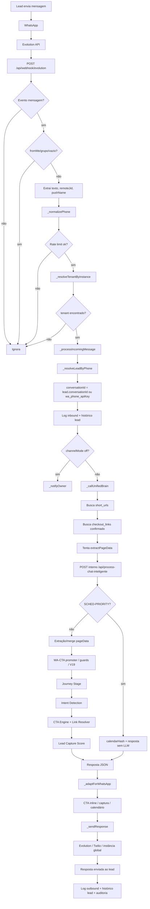

# Pipeline completo do WhatsApp — Link Mágico

> Documento investigativo. Descreve o comportamento encontrado no código, sem propor correções.

## Arquivos principais

| Área | Arquivo/função |
|---|---|
| Canal WhatsApp | `whatsapp-channel.js` (`WhatsAppChannel`) |
| Webhooks | `registerRoutes()`, `_handleEvolutionWebhook()`, `_handleTwilioWebhook()` |
| Tenant | `_resolveTenantByInstance()`, `_resolveTenantByTwilioNumber()` |
| Lead | `_resolveLeadByPhone()` + `getLeadSystem(apiKey)` |
| IA / cérebro | `_callUnifiedBrain()` → `/api/process-chat-inteligente` por padrão |
| Fallback legado | `_callUnifiedBrain()` → `/api/chat-universal` se `WA_USE_FULL_PIPELINE=false` |
| Agendamento | `superInteligencia.detectarAgendamento()` + `schedulingManager.generatePublicHash()` |
| CTA final | `lib/v17-link-resolver`/`_v17LinkResolver`, `sales/cta-engine`, V18/V19 failsafes |
| Lead capture | `lib/lead-capture-score.js` |
| Adaptação WA | `_adaptForWhatsApp()` + tradução de `cta`, `leadCapture`, `calendarHash` |

## 1. Entrada da mensagem

### Evolution

O canal registra `POST /api/webhook/evolution` e `POST /api/webhook/twilio`. O endpoint Evolution responde imediatamente `200 { received: true }` antes de processar a mensagem, para evitar reenvios do provedor.

Fluxo Evolution:

1. Recebe `body`.
2. Lê `event` por `body.event || body.type`.
3. Lê instância por `body.instanceName || body.instance || body.instance_name`.
4. Aceita apenas eventos `Message`, `messages.upsert` ou `messages_upsert`.
5. Suporta dois formatos:
   - Evolution Go v0.7.1: `data.Info.Chat`, `data.Info.IsFromMe`, `data.Info.IsGroup`, `data.Info.ID`, `data.Message`.
   - Evolution API v1: `data.key.remoteJid`, `data.key.fromMe`, `data.message`.
6. Ignora mensagens do próprio bot (`fromMe`) e grupos.
7. Extrai texto de `conversation` ou `extendedTextMessage.text`.
8. Normaliza telefone para E.164 simplificado com `_normalizePhone()`.
9. Aplica rate limit de 30 mensagens por minuto por telefone.
10. Resolve tenant pela instância Evolution.
11. Chama `_processIncomingMessage()` com `apiKey`, `channelMode`, `notificationPhone`, telefone, texto, provider e dados da instância.

### Identificação do tenant e API key

A resolução por Evolution usa cache de 5 minutos (`TENANT_CACHE_TTL`). Primeiro busca `whatsapp_settings` por `evolution_instance_name` ou `saas_instance_name`, exigindo `is_active`. Se não encontrar e a instância começar com `lm_`, tenta fallback por prefixo do `tenant.id` em `api_keys` e `tenants`. Depois busca `channel_mode` em `whatsapp_settings`; se não existir, usa `auto`.

A API key usada no restante do pipeline é `row.api_key` ou `row2.api_key` do fallback por tenant. Ela é passada para o Lead System, para logs, para o endpoint interno e para envio.

### Twilio

O Twilio faz ACK com TwiML vazio (`<Response></Response>`), extrai `From`, `Body`, `MessageSid`, normaliza telefone, resolve tenant pelo número `To` via `whatsapp_settings.twilio_from_number` e converge para `_processIncomingMessage()`.

## 2. Resolução do Lead

`_resolveLeadByPhone(apiKey, phone, pushName)` usa `getLeadSystem(apiKey)` e `leadSystem.getLeads()`.

Ordem:

1. **Reutiliza** lead se `lead.wa_phone === phone`.
2. **Reutiliza e atualiza** lead se `telefone` existente bater com variantes normalizadas (`+55...`, sem `+`, sem `+55`). Nesse caso grava `lead.wa_phone = phone`, preserva `channel` existente ou usa `widget`, e chama `saveLeads()`.
3. **Cria automaticamente** se nada for encontrado. O novo lead recebe `nome` do `pushName` ou `WhatsApp ####`, `email: "Não informado"`, `telefone`, `wa_phone`, `url_origem: whatsapp://...`, `source: whatsapp` e `channel: whatsapp`.
4. Após criação, tenta sincronizar com CRM via `crmManager.syncLeadToCRM(apiKey, newLead)` em modo fire-and-forget; falhas não bloqueiam.

## 3. Inicialização da conversa

Em `_processIncomingMessage()`:

- Primeiro resolve/cria lead.
- `conversationId` prioriza `lead.conversationId` para preservar memória omnichannel com o widget.
- Se o lead não tiver `conversationId`, usa `_makeConversationId(phone, apiKey)`, formato `wa_<phoneDigits>_<apiKey8chars>`.
- Loga inbound em `whatsapp_messages` somente quando `USE_POSTGRES` é verdadeiro.
- Atualiza histórico do lead com `leadSystem.updateLeadConversation(lead.id, text, true)`.
- Depois da resposta enviada, loga outbound e atualiza histórico do lead com `updateLeadConversation(lead.id, adapted, false)`.

Armazenamentos vistos:

| Informação | Local |
|---|---|
| `conversationId` do WA | lead existente ou gerado por `_makeConversationId()` |
| histórico do lead | Lead System (`updateLeadConversation`) |
| mensagens WA | tabela `whatsapp_messages` no PostgreSQL |
| chat ativo/analytics | objeto global `analytics.activeChats` |
| score de captura | `lib/lead-capture-score.js`, Map em memória por `conversationId` |
| buyer state | `global._ppBuyerState`, Map em memória no endpoint inteligente |

## 4. Pipeline principal em produção

O WhatsApp chama `_callUnifiedBrain()`. Por padrão, `WA_USE_FULL_PIPELINE = process.env.WA_USE_FULL_PIPELINE !== 'false'`, então o endpoint chamado é `/api/process-chat-inteligente`. O legado `/api/chat-universal` só executa quando `WA_USE_FULL_PIPELINE=false`.

Portanto, em produção padrão, o fluxo real é:

`WhatsApp → _processIncomingMessage → _callUnifiedBrain → POST interno /api/process-chat-inteligente → resposta estruturada → _adaptForWhatsApp → _sendResponse`.

`_callChatUniversal()` não aparece como função ativa no canal; o fallback é feito escolhendo `endpointPath = '/api/chat-universal'` dentro de `_callUnifiedBrain()`.

## 5. Payload enviado para IA

Payload real montado por `_callUnifiedBrain()`:

```json
{
  "message": "texto do lead",
  "apiKey": "api key do tenant",
  "conversationId": "lead.conversationId ou wa_<phone>_<apiKey8>",
  "leadId": "id do lead, se existir",
  "url": "salesUrl vindo de short_urls, se existir",
  "robotName": "robot_name vindo de short_urls, se existir",
  "instructions": "instructions vindo de short_urls, se existir",
  "pageData": "pageData extraído/enriquecido, se existir",
  "context": { "checkoutLink": "checkout confirmado, se existir" }
}
```

O request interno usa host `127.0.0.1`, porta `process.env.PORT || 3000`, método `POST`, `Content-Type: application/json` e header `X-Internal-Channel: whatsapp`.

## 6. Enriquecimento de contexto

Antes de chamar o endpoint interno, `_callUnifiedBrain()` tenta enriquecer:

1. Busca em `short_urls` o último registro do tenant: `sales_url`, `robot_name`, `instructions`.
2. Se existir `salesUrl`, calcula `md5(salesUrl).substring(0, 16)` e busca `checkout_links.checkout_url` confirmado.
3. Se existir `salesUrl`, tenta `require('./server-utils').extractPageData(salesUrl)`.
4. Se a extração retornar `pageData`, clona em `enrichedPageData`.
5. Se houver checkout confirmado, injeta `checkoutLink` e `checkoutSource: db_confirmed` no `pageData`.
6. Se `server-utils` ou `extractPageData` falhar/ausente, o payload ainda manda `url`, permitindo que `/api/process-chat-inteligente` extraia via `extractPageData(targetUrl)`.

No endpoint inteligente, se `pageData` vier incompleto e houver `url`, ocorre nova extração, merge seguro com campos recebidos e preservação de `checkoutLink` vindo do widget/context. Depois há injeção do checkout confirmado do DB se ainda não houver `checkoutLink`, promoção de WhatsApp como CTA se não houver checkout e existir WA com intenção de conversão, e guard V18 de extração.

Fallbacks:

- Falha na busca de dados do assistente: loga warning e segue com payload mínimo.
- Falha no lookup de checkout: loga warning e segue sem checkout confirmado.
- Falha de extração no canal: endpoint interno pode extrair pela `url`.
- Falha de extração no endpoint: fluxo segue com `processedPageData` parcial/undefined.
- Falha de IA/parse/timeout: canal envia fallback textual “Recebi sua mensagem! Em breve retornaremos.”.

## 7. Journey Stage

No endpoint `/api/process-chat-inteligente`, `journeyStage` é calculado por `journeyAnalyzer.analyzeJourneyStage(message)`. Se houver `leadId` efetivo, o Lead System atualiza a jornada do lead. O valor retorna no JSON final como `journeyStage`.

No caminho de agendamento prioritário, o endpoint retorna `journeyStage: 'agendamento'`. No suporte pré-KB, retorna `journeyStage: 'suporte'`. O canal WhatsApp não recalcula: apenas usa o valor para auditoria e logs.

## 8. Intent Detection

Intenções e sinais aparecem em várias camadas:

- `sistemaInteligencias.capturarInteligencias(message)` produz `inteligenciasDetectadas` usadas em logs, diagnóstico, lead capture e resposta.
- V18.1 força buy intent por keywords como comprar, assinar, pagar, plano, preço, checkout, contratar.
- Pré-KB intercepta suporte/handoff por frases como “quero atendente”, “falar com humano”, “suporte”.
- V17.2 Link Resolver detecta intent para decidir CTA estruturado.
- V19 deterministic engine pode decidir intent/stage/CTA quando ativo.
- `lib/lead-capture-score.js` traduz sinais em `dcIntent` (`buy`, `interest`, `info`, `human`, `post_sale`, `objection`) e sinais comerciais.

No canal WhatsApp, a utilização principal é consumir o resultado do pipeline: `inteligenciasDetectadas`, `journeyStage`, `cta`, `leadCapture`, `calendarHash`. O canal não implementa inteligência comercial própria.

## 9. Lead Capture

O endpoint inteligente avalia captura no bloco “CHAT FIRST” com `lib/lead-capture-score.js`, apenas se:

- `_chatFirstEnabled` estiver ativo;
- houver `conversationId`;
- `req.body.leadId` **não** existir.

Isso é importante para WhatsApp: `_callUnifiedBrain()` envia `leadId` quando `_resolveLeadByPhone()` encontra/cria lead. Assim, no caminho normal do WhatsApp, a condição `!req.body.leadId` tende a impedir a avaliação de captura inline no endpoint. Mesmo assim, se o endpoint retornar `leadCapture.shouldCapture`, o canal traduz para texto somente se o lead ainda não tiver `email_captured`.

O score acumula em memória por `conversationId`, TTL de 1 hora. Dispara quando não é despedida, ainda não mostrou captura e uma das condições ocorre: score >= 50, `dcIntent === 'buy'`, v13 `READY_TO_BUY`, `checkoutCandidate`, ou `ctaCandidate`.

## 10. CTA Engine e links

Há múltiplas camadas:

1. `sales/cta-engine` pode gerar CTA e aplicar texto, se `FEATURE_SMART_CTA` estiver ativa.
2. `lib/link-resolver` resolve checkout por prioridade: contexto/widget, `checkoutUrl`, configuração tenant, env `DEFAULT_CHECKOUT_URL`.
3. V17.2 remove CTAs antigos, detecta intent e cria `_intCta` estruturado com link seguro.
4. Channel Resolver pode garantir saída acionável para suporte sem mexer em checkout.
5. V19 pode aplicar decisão determinística; caso contrário, V18.4 força CTA se há checkout e buy intent/buyer state.
6. O WhatsApp injeta `aiResult.cta.url` como texto inline se o link ainda não estiver na resposta.
7. O canal removeu injeção automática de WhatsApp de contato, porque o lead já está no WhatsApp.

## 11. Scheduler

`superInteligencia.detectarAgendamento(message)` roda cedo em `/api/process-chat-inteligente`, antes de KB-FIRST. Ele exige frases explícitas como “quero agendar”, “marcar reunião”, “agendar consulta”, “ver horários”. Se detectar, retorna `gerarOpcoesAgendamento()` com `[CALENDAR_WIDGET]`.

Quando intercepta:

- Atualiza histórico do lead se conseguir resolver `leadId`.
- Faz tracking de billing.
- Gera `calendarHash` via `schedulingManager.generatePublicHash(apiKey)`.
- Retorna imediatamente, sem LLM e sem o restante do pipeline.
- JSON retorna `calendarHash`, `journeyStage: agendamento`, `metadata.method: scheduling-priority`.

No fluxo principal, se a resposta contém `[CALENDAR_WIDGET]`, há injeção posterior de `mainFlowCalendarHash`. No WhatsApp, `calendarHash` vira link `/agendar/<hash>`, mas só é exibido se o lead já tem dados ou se o pipeline não pediu captura; caso contrário, o agendamento é adiado para respeitar a ordem captura → agendamento.

## 12. Adaptação final para WhatsApp

`_adaptForWhatsApp(response)`:

- Converte `[CALENDAR_WIDGET]` em frase textual pedindo dia/horário.
- Remove `[CTA:...]`, `[OUT]`, `<s>`.
- Converte Markdown para formato WhatsApp: `**bold**` → `*bold*`, `__italic__` → `_italic_`, `~~strike~~` → `~strike~`.
- Remove HTML.
- Compacta quebras de linha.
- Trunca para 4096 caracteres.

Depois da adaptação:

- CTA estruturado vira bloco inline com label e URL.
- `leadCapture.shouldCapture` vira pergunta textual de captura.
- `calendarHash` vira URL clicável `/agendar/<hash>`.
- Envio usa, em ordem: Evolution Go direto `/send/text`, instância tenant do `whatsappMgr`, instância global.

## 13. Dependências ocultas e acoplamentos

- `whatsapp-channel.js` depende do `server.js` estar ouvindo localmente na mesma porta.
- O pipeline de IA é chamado por HTTP interno, não por função direta.
- `short_urls` é fonte implícita de `salesUrl`, `robotName`, `instructions`.
- `checkout_links` usa hash MD5 truncado de `salesUrl`.
- `server-utils.extractPageData` é opcional; se ausente, a extração muda de camada para o endpoint.
- `requireApiKey`/`billingMiddleware` precisam aceitar `apiKey` no body para a chamada interna.
- `LeadCaptureScore` pode não rodar para WhatsApp por causa de `leadId` no body.
- Scheduler depende de `schedulingManager` e `BASE_URL`/`RENDER_EXTERNAL_URL` para link público.
- Envio Evolution depende de `CENTRAL_EVOLUTION_URL`, `CENTRAL_EVOLUTION_API_KEY` ou `instanceToken`.
- Logs WA dependem de `USE_POSTGRES` e tabela `whatsapp_messages`.
- Memórias importantes são in-memory (`sessionScores`, `_ppBuyerState`, rate limit, tenant cache).

## 14. Fluxo visual



## 15. Pontos críticos

### Top 20 riscos de regressão

1. Mudança no formato do webhook Evolution.
2. Instância sem correspondência em `whatsapp_settings`.
3. Fallback `lm_` quebrado por mudança em tenant IDs.
4. `channel_mode` ausente ou valores inesperados.
5. `requireApiKey` deixar de aceitar `apiKey` no body.
6. Endpoint interno indisponível na porta local.
7. Timeout de 30s da IA.
8. `server-utils.extractPageData` ausente mudando fallback.
9. `short_urls` sem registro para tenant.
10. Hash de checkout incompatível com `salesUrl`.
11. `leadId` enviado impedir Lead Capture Score no WhatsApp.
12. `calendarHash` sem `BASE_URL` correto.
13. `[CALENDAR_WIDGET]` removido antes do hash.
14. CTA duplicado por camadas V17/V18/V19/WA inline.
15. Remoção agressiva de HTML/Markdown no WhatsApp.
16. Mensagem >4096 truncada perdendo link.
17. `wa_phone` salvo sem persistência por erro em `saveLeads()`.
18. CRM sync fire-and-forget mascarar falhas.
19. Rate limit in-memory reiniciar em deploy/escala.
20. Tenant cache manter configuração desatualizada por 5 minutos.

### Top 20 dependências ocultas

1. `server.js` local.
2. `PORT`.
3. `short_urls`.
4. `checkout_links`.
5. `whatsapp_settings`.
6. `api_keys`.
7. `tenants`.
8. `whatsapp_messages`.
9. `server-utils`.
10. `extractPageData` global do endpoint.
11. `billingMiddleware`.
12. `requireApiKey`.
13. `featureFlags`.
14. `_v17LinkResolver`.
15. `_urlGuard`.
16. `_waCTAPromoter`.
17. `_v18Guard`.
18. `_v19Engine`.
19. `schedulingManager`.
20. `crmManager`.

### Top 20 componentes críticos

1. `_handleEvolutionWebhook()`.
2. `_resolveTenantByInstance()`.
3. `_processIncomingMessage()`.
4. `_resolveLeadByPhone()`.
5. `_callUnifiedBrain()`.
6. `/api/process-chat-inteligente`.
7. `extractPageData()`.
8. `superInteligencia.detectarAgendamento()`.
9. `journeyAnalyzer.analyzeJourneyStage()`.
10. `sistemaInteligencias.capturarInteligencias()`.
11. `sales/cta-engine`.
12. V17.2 Link Resolver.
13. URL Guard.
14. Channel Resolver Safe.
15. V18.4 fallback.
16. V19 deterministic engine.
17. `lib/lead-capture-score.js`.
18. `_adaptForWhatsApp()`.
19. `_sendResponse()`.
20. `_logMessage()`.

## 16. Comparação com Link Curto

| Dimensão | WhatsApp | Link Curto / Widget |
|---|---|---|
| Entrada | Webhook Evolution/Twilio | Frontend/widget chamando endpoints HTTP |
| Tenant | Instância/número → `whatsapp_settings` → `apiKey` | API key validada diretamente no request/link |
| Contexto inicial | Busca `short_urls` por `apiKey`, tenta extrair `salesUrl` | Widget pode enviar `pageData`, `url`, checkout detectado |
| Lead | Resolve/cria automaticamente por telefone antes da IA | Captura pode ocorrer inline, formulário/chat-first |
| `conversationId` | Prioriza `lead.conversationId`; senão `wa_<phone>_<apiKey8>` | Vem do widget/cliente |
| Pipeline | Usa o mesmo `/api/process-chat-inteligente` por padrão | Chama `/api/process-chat-inteligente` diretamente |
| Lead Capture | Canal traduz `leadCapture`; endpoint pode não avaliar se `leadId` veio no body | Chat-first avalia quando não há `leadId` |
| CTA | CTA estruturado vira texto inline | Pode renderizar botão/widget |
| Scheduler | `calendarHash` vira link `/agendar/<hash>` | Pode renderizar `[CALENDAR_WIDGET]` visual |
| Handoff | Pré-KB pode retornar WhatsApp do site, mas canal remove injeção genérica de contato | Pode mostrar WhatsApp/links como CTA ou suporte |
| Persistência | `whatsapp_messages`, Lead System, histórico do lead | Histórico e analytics do chat/widget |
| Envio final | Evolution/Twilio/instância global | Resposta HTTP ao navegador/widget |

## Conclusão operacional

O WhatsApp foi implementado como canal de transporte com paridade V21: ele recebe, normaliza, resolve tenant e lead, chama o mesmo pipeline do Link Curto e traduz sinais estruturados para texto de WhatsApp. O comportamento comercial real — journey, intent, CTA, scheduler, guards, lead capture — mora majoritariamente em `/api/process-chat-inteligente`. O canal WhatsApp ainda tem responsabilidades críticas: identificação por instância, criação/vinculação de lead por telefone, enriquecimento via `short_urls`, adaptação de widgets/CTAs/calendário para texto e envio pela instância correta.
