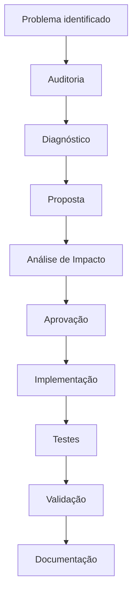

# 00_ARQUITETURA_GOVERNANCA.md

# Arquitetura e Governança Técnica
## Link Mágico SaaS Platform

Versão: 1.0

Status: Documento Mestre

Tipo: Governança Arquitetural

Última atualização: Julho/2026

---

# Objetivo

Este documento estabelece os princípios de governança arquitetural do Link Mágico.

Ele define:

- como a arquitetura deve ser documentada;
- como decisões técnicas devem ser registradas;
- quais documentos representam o estado atual do sistema;
- quais documentos representam propostas futuras;
- como distinguir fatos de hipóteses;
- como reduzir regressões arquiteturais.

Este documento não descreve implementação.

Ele descreve como a arquitetura deve ser compreendida, analisada e evoluída.

---

# Motivação

O Link Mágico evoluiu durante muitos meses através de sucessivas versões da plataforma.

Ao longo dessa evolução surgiram diversos módulos especializados:

- Decision Core
- Sales Layer
- CTA Engine
- Unified Brain (V17)
- V18 Extraction
- V19 Deterministic Engine
- V21 Hardening
- Checkout Authority
- Link Resolver
- Force Checkout
- Feature Flags
- entre outros.

Cada nova versão resolveu problemas importantes.

Entretanto, em diversos momentos, novas camadas passaram a executar responsabilidades semelhantes às das versões anteriores.

Esse crescimento incremental tornou a arquitetura extremamente poderosa, porém aumentou significativamente a complexidade do sistema.

A consequência observada foi o aumento do risco de regressões, principalmente devido à sobreposição de responsabilidades entre módulos.

Este conjunto de documentos foi criado para organizar esse conhecimento e estabelecer uma governança clara para a evolução da plataforma.

---

# Filosofia da Arquitetura

A arquitetura do Link Mágico deve seguir os seguintes princípios.

## Responsabilidade Única

Cada responsabilidade arquitetural deve possuir apenas um módulo considerado autoridade.

Exemplos:

- intenção
- CTA
- checkout
- resolução de links
- extração
- captura de leads

Cada uma dessas responsabilidades deve possuir apenas um dono.

---

## Separação entre decisão e consumo

Todo módulo pertence a um dos grupos abaixo.

### Autoridade

Possui permissão para criar ou alterar uma decisão.

Exemplos:

- definir intenção
- escolher checkout
- decidir CTA

---

### Consumidor

Recebe uma decisão já produzida.

Não possui autorização para alterá-la.

Pode apenas utilizá-la.

---

### Validador

Pode verificar consistência.

Pode impedir estados inválidos.

Não pode alterar regras de negócio.

---

### Observador

Apenas registra informações.

Exemplos:

Analytics

Logs

Learning

Métricas

---

# Objetivos Arquiteturais

Os principais objetivos da arquitetura são:

- reduzir regressões;
- eliminar sobreposição de decisões;
- facilitar manutenção;
- permitir evolução incremental;
- preservar compatibilidade entre versões;
- facilitar auditorias;
- reduzir acoplamento.

---

# Estrutura da Documentação

A documentação arquitetural é composta pelos seguintes documentos.

---

## 00_ARQUITETURA_GOVERNANCA.md

Documento mestre.

Define princípios.

---

## 01_ESTADO_ATUAL_AS_IS.md

Descreve apenas fatos.

Nenhuma proposta.

---

## 02_DIAGNOSTICO_ARQUITETURAL.md

Descreve problemas observados.

Duplicações.

Riscos.

Conflitos.

---

## 03_MATRIZ_DE_AUTORIDADE.md

Define:

quem decide

quem consome

quem valida

quem observa

---

## 04_CONTRATOS_ARQUITETURAIS.md

Define o estado arquitetural desejado.

Não representa necessariamente o comportamento atual.

---

## 05_ROADMAP_DE_MIGRACAO.md

Descreve a evolução incremental da arquitetura.

---

## 06_GLOSSARIO.md

Define conceitos técnicos utilizados na plataforma.

---

## 07_MATRIZ_DE_CONFIANCA.md

Classifica o nível de confiança de cada afirmação arquitetural.

---

## 08_PRINCIPIOS_DE_GOVERNANCA.md

Estabelece regras obrigatórias para evolução da plataforma.

---

## 09_CHECKLIST_DE_VALIDACAO.md

Checklist obrigatório antes de qualquer alteração.

---

# Classificação das Informações

Toda informação presente na documentação deve pertencer exatamente a uma das categorias abaixo.

---

## 1. Estado Atual (AS-IS)

Representa comportamento comprovadamente existente.

Critérios de validação:

✔ inspeção do código

ou

✔ documentação oficial

ou

✔ execução dinâmica

ou

✔ testes automatizados

O Estado Atual nunca deve conter sugestões de melhoria.

---

## 2. Diagnóstico Arquitetural

Representa padrões observados.

Exemplos:

duplicações

sobreposições

riscos

acoplamentos

complexidade

O diagnóstico descreve problemas.

Não define soluções.

---

## 3. Hipóteses

Representam conclusões ainda não comprovadas.

Uma hipótese somente poderá migrar para Estado Atual após validação.

Enquanto isso permanecerá explicitamente identificada.

---

## 4. Arquitetura Alvo

Representa a arquitetura desejada para o futuro.

Inclui:

contratos

governança

responsabilidades

roadmap

A Arquitetura Alvo não representa necessariamente o comportamento atual.

---

# Matriz de Confiança

Toda afirmação arquitetural deve possuir um nível de confiança.

---

🟢 Alta

Confirmada por:

- código
- documentação
- testes
- execução

---

🟡 Média

Fortemente suportada por evidências.

Ainda necessita confirmação adicional.

---

🟠 Baixa

Existem indícios.

Necessita investigação.

---

🔵 Proposta

Não descreve o sistema atual.

Representa decisão arquitetural futura.

---

# Fontes de Evidência

Nenhuma conclusão arquitetural poderá ser considerada Estado Atual sem pelo menos uma das seguintes evidências.

- Código-fonte
- Documentação oficial
- Logs de execução
- Testes automatizados
- Auditoria dinâmica

Caso contrário será registrada como hipótese ou proposta.

---

# Processo de Evolução

Toda alteração arquitetural deverá seguir obrigatoriamente o fluxo abaixo.

Nenhuma etapa deverá ser ignorada.

---

# Compatibilidade

A evolução da plataforma deve preservar obrigatoriamente:

- Widget
- Widget Fullscreen
- Link Curto
- WhatsApp
- CRM
- Billing
- Scheduler
- Multi Tenant
- Analytics
- Login
- Backup
- Segurança

Mudanças incompatíveis deverão possuir Feature Flag.

---

# Feature Flags

Toda alteração relevante deverá ser:

- incremental
- reversível
- isolada

Sempre que possível:

- protegida por Feature Flag;
- possuir rollback simples;
- registrar logs estruturados;
- manter compatibilidade.

---

# Governança de Autoridade

Cada responsabilidade deverá possuir exatamente um módulo considerado autoridade.

Os demais módulos poderão apenas:

- consumir;
- validar;
- observar.

Nenhum módulo poderá alterar silenciosamente decisões produzidas por outra autoridade.

---

# Princípio da Não Regressão

Toda alteração arquitetural deverá responder às seguintes perguntas:

Quem é o dono dessa responsabilidade?

Existe outro módulo fazendo a mesma função?

Essa alteração cria uma nova autoridade?

Existe rollback?

Existe Feature Flag?

Existe validação manual?

Se qualquer resposta for negativa, a alteração deverá ser reavaliada.

---

# Objetivo Final

O objetivo da arquitetura do Link Mágico é transformar a plataforma em um sistema onde:

- cada responsabilidade possui um único dono;
- decisões não são duplicadas;
- pipelines são previsíveis;
- módulos possuem baixo acoplamento;
- regressões são minimizadas;
- novas funcionalidades possam ser adicionadas sem comprometer componentes existentes.

Este documento serve como referência permanente para toda decisão arquitetural futura.