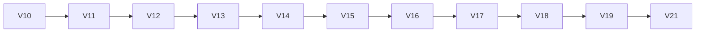

# 02_DIAGNOSTICO_ARQUITETURAL.md

# Diagnóstico Arquitetural

Versão: 1.0

Status: Auditoria Técnica

Tipo: Diagnóstico

---

# Objetivo

Este documento registra os problemas arquiteturais observados durante a auditoria do Link Mágico.

Seu propósito não é propor soluções.

Seu objetivo é identificar:

- duplicações;
- sobreposições;
- conflitos;
- acoplamentos;
- riscos;
- causas prováveis das regressões.

Todas as propostas de evolução encontram-se nos documentos posteriores.

---

# Escopo

Este documento analisa exclusivamente a arquitetura.

Não avalia:

- qualidade de código;
- estilo;
- performance;
- infraestrutura.

O foco é:

quem decide

quem modifica

quem possui autoridade

quem interfere em outro módulo

---

# Visão Geral

A arquitetura do Link Mágico evoluiu por sucessivas camadas.

Cada nova versão adicionou funcionalidades importantes.

Entretanto, em diversos momentos, novas camadas passaram a executar responsabilidades anteriormente desempenhadas por módulos legados.

O resultado observado foi uma arquitetura onde múltiplos componentes podem atuar sobre a mesma decisão.

Esse padrão aumenta significativamente o risco de regressões.

---

# Principal Conclusão

A maior parte das regressões observadas não decorre de bugs isolados.

A principal causa identificada é a existência de múltiplas autoridades executando responsabilidades equivalentes.

Em diversos fluxos, mais de um módulo possui capacidade de modificar a mesma decisão.

Esse comportamento caracteriza sobreposição de autoridade arquitetural.

---

# Evolução Incremental

A evolução histórica da plataforma pode ser representada de forma simplificada.



Em diversos pontos da evolução, novas versões coexistiram com versões anteriores.

Nem todas substituíram completamente o comportamento legado.

---

# Padrão Arquitetural Observado

Em vez de substituir motores anteriores, a plataforma frequentemente adicionou novos motores ao pipeline existente.

Exemplo conceitual:

```text
Motor A

↓

Motor B

↓

Motor C

↓

Motor D

↓

Motor E
```

Cada motor pode modificar parcialmente o resultado produzido anteriormente.

Esse padrão aumenta o acoplamento entre camadas.

---

# Diagnóstico 01

## Duplicação de Autoridade

Foi observada duplicação potencial de autoridade em diversas responsabilidades.

Entre elas:

- intenção;
- CTA;
- checkout;
- links;
- captura de lead;
- decisão comercial.

A duplicação de autoridade significa que mais de um módulo possui capacidade de alterar o mesmo atributo.

---

# Diagnóstico 02

## Sobreposição de Pipeline

Foram identificados pipelines que processam informações semelhantes.

Exemplos observados:

Decision Core

↓

Decision Engine

↓

V16

↓

V17

↓

V19

Todos participam, em diferentes níveis, do processamento de decisões comerciais.

---

Outro exemplo:

Extração

↓

RAG

↓

Deep Context

↓

V18

↓

Fallback

Todos podem enriquecer informações estruturadas.

---

Outro exemplo:

Link Resolver

↓

V17 Link Resolver

↓

ResolveLink()

Todos participam da resolução de links.

---

# Diagnóstico 03

## Decisão Reprocessada

Em vários fluxos, uma decisão já produzida pode voltar a ser analisada posteriormente.

Exemplo conceitual:

Intent

↓

CTA

↓

Checkout

↓

Hardening

↓

Nova decisão

↓

Nova alteração

Esse padrão dificulta prever qual módulo possui a decisão final.

---

# Diagnóstico 04

## Acoplamento entre Camadas

Diversos módulos possuem dependências indiretas.

Exemplos:

Sales Layer

↓

Checkout

↓

CTA

↓

Decision

↓

Hardening

Quanto maior o número de camadas modificando o mesmo objeto, maior o risco de efeitos colaterais.

---

# Diagnóstico 05

## Conflito de Autoridade

Foi observado que diferentes módulos podem chegar a conclusões distintas.

Exemplo conceitual:

```text
Decision Core

↓

BUY
```

↓

```text
V17

↓

NO CTA
```

↓

```text
V21

↓

BUY
```

↓

```text
Checkout
```

Nesse cenário existe conflito entre motores.

---

# Diagnóstico 06

## Múltiplos Resolvedores

Durante a auditoria foram identificados resolvedores especializados.

Exemplos:

- Link Resolver
- V17 Link Resolver
- ResolveLink()

Também foram identificados resolvedores de checkout.

Exemplos:

- Checkout Authority
- Force Checkout
- Checkout Fallback
- Safe Checkout

A coexistência de resolvedores exige definição clara de autoridade.

---

# Diagnóstico 07

## Extração Distribuída

O processo de extração envolve diversos componentes.

Entre eles:

- Crawlers
- Deep Context
- V11
- V18
- Guards
- Fallbacks

Esses componentes podem atuar sobre os mesmos dados.

---

# Diagnóstico 08

## Hardening

A camada V21 foi criada para aumentar robustez.

Entretanto, durante a auditoria foram identificados cenários onde alterações posteriores podem modificar decisões produzidas anteriormente.

Esse comportamento aumenta o risco de regressões quando responsabilidades não estão claramente separadas.

---

# Diagnóstico 09

## Crescimento por Camadas

A arquitetura apresenta forte característica evolutiva.

Novas funcionalidades foram adicionadas preservando compatibilidade com versões anteriores.

Esse modelo oferece grande estabilidade operacional, porém aumenta gradualmente a complexidade da arquitetura.

---

# Diagnóstico 10

## Feature Flags

Feature Flags desempenham papel central na plataforma.

Elas permitem:

- migração incremental;
- rollback;
- validação;
- experimentação.

Ao mesmo tempo, diferentes combinações de Feature Flags podem alterar significativamente o pipeline executado.

---

# Principais Áreas de Atenção

Durante a auditoria foram identificadas como áreas críticas:

- decisão comercial;
- intenção;
- CTA;
- checkout;
- resolução de links;
- extração;
- pipeline conversacional.

Essas áreas concentram maior potencial de sobreposição arquitetural.

---

# Causa Estrutural das Regressões

A hipótese arquitetural predominante é que parte significativa das regressões decorre da combinação de três fatores.

## Crescimento incremental

Novos motores foram adicionados sem remoção completa dos anteriores.

---

## Sobreposição de responsabilidades

Mais de um módulo participa da mesma decisão.

---

## Múltiplas autoridades

Mais de um componente pode alterar o mesmo atributo durante o pipeline.

---

# Consequências Observadas

Esse padrão arquitetural tende a produzir:

- decisões inconsistentes;
- divergência entre canais;
- comportamento difícil de prever;
- regressões indiretas;
- dificuldade de depuração;
- aumento do custo de manutenção.

---

# Limitações da Auditoria

Este diagnóstico foi produzido a partir de:

- documentação;
- análise estática;
- estrutura do projeto;
- histórico técnico.

Nem todas as conclusões representam comportamento confirmado em tempo de execução.

Sempre que possível, hipóteses deverão ser validadas através de:

- inspeção do código;
- logs;
- testes;
- execução dinâmica.

---

# Próximo Documento

Este documento identifica os problemas.

O documento seguinte (**03_MATRIZ_DE_AUTORIDADE.md**) estabelece quem deve possuir autoridade sobre cada responsabilidade arquitetural, distinguindo claramente:

- quem decide;
- quem apenas consome;
- quem apenas valida;
- quem apenas observa.

Ele representa a transição entre o diagnóstico e a definição da governança arquitetural.