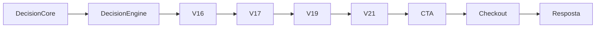
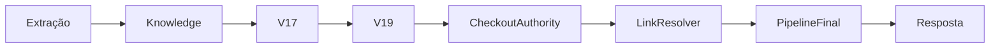

# 05_ROADMAP_DE_MIGRACAO.md

# Roadmap de Migração Arquitetural

Versão: 1.0

Status: Planejamento

Tipo: Arquitetura Alvo

---

# Objetivo

Este documento define a estratégia oficial para evolução arquitetural do Link Mágico.

Seu objetivo é estabelecer uma sequência de migrações que permita evoluir a arquitetura de forma:

- incremental;
- reversível;
- segura;
- auditável;
- compatível com produção.

Este documento não descreve implementações específicas.

Ele descreve a ordem lógica das mudanças arquiteturais.

---

# Princípios

Toda migração deverá preservar:

- Widget
- Widget Fullscreen
- WhatsApp
- CRM
- Billing
- Scheduler
- Multi Tenant
- Analytics
- Login
- Backup
- Segurança
- APIs existentes

Nenhuma etapa poderá comprometer a operação do sistema.

---

# Filosofia

A arquitetura atual é resultado de uma evolução incremental.

O objetivo deste roadmap não é reconstruir a plataforma.

O objetivo é reduzir gradualmente:

- duplicações;
- sobreposições;
- conflitos;
- acoplamentos;
- regressões.

Cada etapa deve produzir uma arquitetura mais previsível que a anterior.

---

# Estratégia Geral

A migração seguirá quatro princípios fundamentais.

## 1. Observar antes de alterar

Toda alteração deve ser precedida por auditoria.

Nunca modificar comportamento sem compreender completamente o pipeline.

---

## 2. Consolidar antes de remover

Sempre que dois módulos executarem a mesma responsabilidade:

Primeiro:

definir autoridade.

Depois:

fazer todos consumirem essa autoridade.

Somente então remover duplicações.

---

## 3. Shadow Mode

Sempre que possível:

novo comportamento

↓

executa em paralelo

↓

gera logs

↓

não altera resposta

↓

comparação

↓

aprovação

↓

ativação

---

## 4. Pequenos passos

Grandes refatorações são proibidas.

A migração ocorrerá por pequenas etapas independentes.

---

# Estado Atual

Arquitetura simplificada observada.



Diversos módulos ainda podem alterar a mesma decisão.

---

# Estado Alvo

Arquitetura desejada.



Validação ocorre paralelamente.

Analytics observa.

Learning observa.

Nenhum módulo modifica decisões anteriores.

---

# FASE 0

## Congelamento Arquitetural

Objetivo:

interromper crescimento desordenado.

---

Durante esta fase:

Nenhuma nova responsabilidade poderá ser criada.

Toda alteração deverá respeitar:

03_MATRIZ_DE_AUTORIDADE.md

04_CONTRATOS_ARQUITETURAIS.md

---

Critério de saída:

Toda mudança passa por revisão arquitetural.

---

# FASE 1

## Inventário

Objetivo:

identificar todas as autoridades existentes.

---

Entregáveis

Mapa completo de:

- intenção
- CTA
- checkout
- links
- extração
- captura

---

Resultado esperado

Conhecimento completo da arquitetura atual.

---

# FASE 2

## Shadow Mode

Objetivo

Executar novos motores sem alterar comportamento.

---

Exemplo

V17

↓

Resposta Oficial

---

V19

↓

Shadow

↓

Logs

↓

Comparação

---

Resultado esperado

Diferenças documentadas.

Nenhuma alteração em produção.

---

# FASE 3

## Consolidação das Autoridades

Objetivo

Garantir autoridade única para cada responsabilidade.

---

Nesta fase:

não remover código.

Apenas impedir decisões paralelas.

---

Exemplo

Hoje

Decision Core

↓

V17

↓

V21

↓

CTA

---

Depois

Decision Core

↓

Consumidor

↓

V17

↓

Autoridade

↓

V21

↓

Validador

---

Critério

Somente uma decisão poderá existir.

---

# FASE 4

## Consumidores

Objetivo

Transformar motores antigos em consumidores.

---

Exemplos

Decision Core

↓

consome

---

Sales Layer

↓

consome

---

V16

↓

consome

---

Resultado

Compatibilidade preservada.

Duplicações reduzidas.

---

# FASE 5

## Validadores

Objetivo

Separar validação de decisão.

---

Exemplo

Antes

V21

↓

decide

↓

corrige

↓

muda resposta

---

Depois

V21

↓

valida

↓

aceita

↓

rejeita

↓

não decide

---

Resultado

Hardening previsível.

---

# FASE 6

## Limpeza Arquitetural

Objetivo

Remover responsabilidades duplicadas.

---

Somente após:

Shadow

Logs

Testes

Validação

Compatibilidade

---

Nunca remover código sem evidência.

---

# FASE 7

## Simplificação dos Pipelines

Objetivo

Reduzir profundidade.

---

Antes

```text
Decision

↓

Sales

↓

V17

↓

V19

↓

CTA

↓

Checkout

↓

Hardening

↓

Resposta
```

---

Depois

```text
Extração

↓

Knowledge

↓

V17

↓

V19

↓

Resposta
```

---

Resultado

Pipeline previsível.

---

# FASE 8

## Observabilidade

Objetivo

Toda decisão crítica deverá produzir logs estruturados.

Exemplos

Intent

CTA

Checkout

Buyer Stage

Links

Lead Capture

Extração

---

Resultado

Reconstrução completa do pipeline.

---

# FASE 9

## Remoção Controlada

Objetivo

Eliminar duplicações históricas.

---

Critérios

Shadow validado.

Feature Flag.

Rollback.

Testes.

Compatibilidade.

---

Nunca remover módulos diretamente.

Primeiro remover responsabilidade.

Depois remover código.

---

# Critérios de Aprovação

Cada etapa deverá responder positivamente:

Existe Feature Flag?

Existe rollback?

Existe teste?

Existe log?

Existe validação manual?

Existe documentação?

Existe compatibilidade?

Se qualquer resposta for negativa:

A migração não poderá prosseguir.

---

# Critérios de Encerramento

O roadmap será considerado concluído quando:

- Cada responsabilidade possuir uma única autoridade.
- Não existirem decisões paralelas.
- Hardening apenas validar.
- Analytics apenas observar.
- Learning apenas aprender.
- Pipelines forem determinísticos.
- Todos os contratos arquiteturais estiverem respeitados.

---

# Indicadores de Sucesso

A evolução arquitetural deverá resultar em:

- redução de regressões;
- redução de acoplamento;
- menor complexidade dos pipelines;
- maior previsibilidade;
- facilidade de auditoria;
- facilidade de manutenção;
- maior segurança para evolução futura.

---

# Riscos

Durante a migração deverão ser monitorados:

- regressões indiretas;
- divergência entre canais;
- Feature Flags conflitantes;
- diferenças entre Shadow Mode e Produção;
- alterações silenciosas de comportamento.

Todo risco identificado deverá ser documentado antes da próxima etapa.

---

# Relação com os Demais Documentos

Este roadmap depende diretamente de:

- 00_ARQUITETURA_GOVERNANCA.md
- 01_ESTADO_ATUAL_AS_IS.md
- 02_DIAGNOSTICO_ARQUITETURAL.md
- 03_MATRIZ_DE_AUTORIDADE.md
- 04_CONTRATOS_ARQUITETURAIS.md

As fases aqui descritas representam o caminho entre a arquitetura atual (AS-IS) e a arquitetura alvo (TO-BE).

Nenhuma etapa deste roadmap substitui a necessidade de auditoria, testes ou validação técnica.

---

# Cláusula Final

A migração arquitetural do Link Mágico deverá ser conduzida como um processo contínuo de evolução, e não como uma grande refatoração.

Cada mudança deve reduzir a complexidade do sistema sem comprometer sua estabilidade operacional.

O sucesso da migração será medido não pela quantidade de código removido, mas pela clareza das responsabilidades, pela redução das regressões e pela previsibilidade da arquitetura.