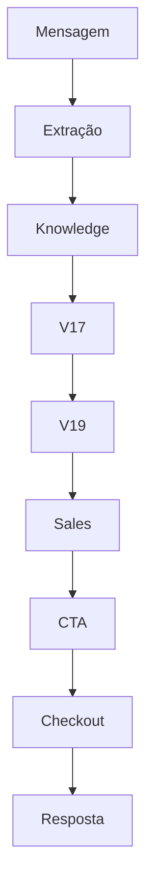
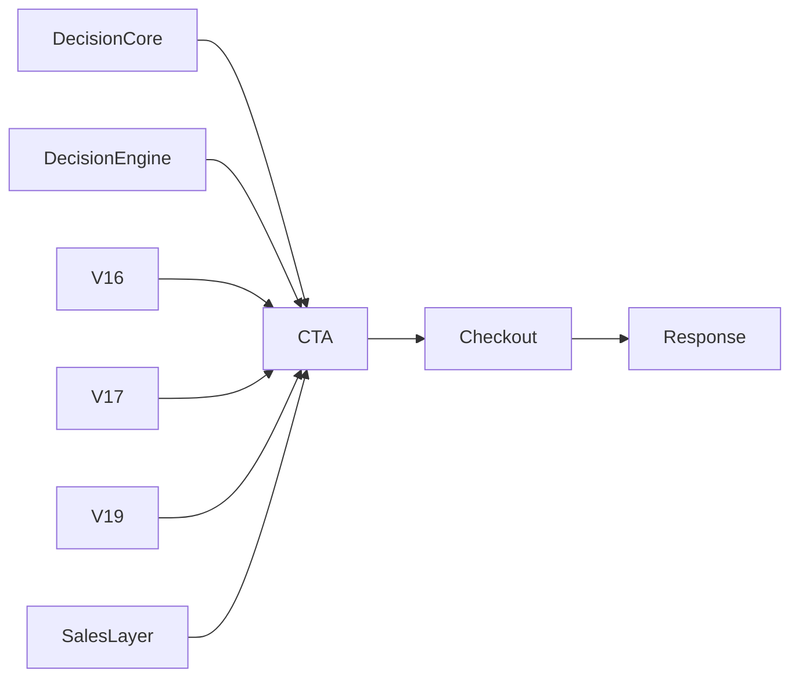

# 11_MAPA_DE_PIPELINES.md

> **Status:** Documento de Governança Arquitetural
>
> **Classificação:** Estado Atual (AS-IS)
>
> **Versão:** 1.0
>
> **Objetivo:** Documentar todos os pipelines existentes no Link Mágico, identificar responsabilidades, pontos de entrada, módulos envolvidos, consumidores das decisões, sobreposições e pontos críticos para futuras auditorias.

---

# 1. Objetivo

O Link Mágico evoluiu durante diversos ciclos de desenvolvimento, incorporando sucessivas camadas arquiteturais (V10, V11, V12, V13, V14, V15, V16, V17, V18, V19 e V21).

Essa evolução trouxe benefícios funcionais importantes, porém também resultou em múltiplos pipelines coexistindo dentro da aplicação.

Este documento tem como finalidade:

* documentar o fluxo real da aplicação;
* identificar onde cada pipeline começa e termina;
* mapear responsabilidades;
* localizar pontos de decisão;
* identificar sobreposições;
* servir como referência para auditorias futuras.

Este documento **não propõe alterações**.

Seu objetivo é exclusivamente descritivo.

---

# 2. Conceito de Pipeline

Neste documento, pipeline representa uma sequência organizada de etapas pelas quais uma informação percorre até produzir um resultado final.

Exemplo:

```text
Mensagem

↓

Extração

↓

Conhecimento

↓

Decisão

↓

Resposta
```

Cada pipeline possui:

* ponto de entrada;
* processamento;
* pontos de decisão;
* consumidores;
* resultado final.

---

# 3. Classificação dos Pipelines

Durante a auditoria foram identificados os seguintes grupos.

## Pipelines Conversacionais

Responsáveis pelo processamento de mensagens.

Exemplos:

* Widget
* WhatsApp
* API
* Link Curto

---

## Pipelines de Conhecimento

Responsáveis por enriquecer contexto.

Exemplos:

* Crawl
* RAG
* Deep Context
* Knowledge Base

---

## Pipelines Comerciais

Responsáveis por venda.

Exemplos:

* Decision Core
* Sales Layer
* CTA
* Closing
* Checkout

---

## Pipelines Operacionais

Responsáveis por infraestrutura.

Exemplos:

* CRM
* Scheduler
* Billing
* Analytics
* Lead Capture

---

# 4. Pipeline Global

Visão simplificada.

```text
Entrada

↓

Extração

↓

Conhecimento

↓

Classificação

↓

Decisão

↓

Estratégia Comercial

↓

CTA

↓

Checkout

↓

Resposta

↓

Persistência

↓

Analytics
```

Este fluxo representa apenas uma visão conceitual.

A implementação real possui múltiplos caminhos paralelos.

---

# 5. Entradas do Sistema

O sistema recebe mensagens por diversos canais.

Cada canal inicia um pipeline específico.

## Widget Inline

Origem:

```text
Usuário

↓

Widget

↓

Frontend

↓

API

↓

Server
```

Responsabilidades:

* abrir conversa;
* identificar tenant;
* criar sessão;
* enviar mensagem.

---

## Widget Fullscreen

Fluxo semelhante ao Widget Inline.

Diferença:

* experiência de interface;
* controle visual.

O pipeline interno permanece equivalente.

---

## WhatsApp

Fluxo:

```text
Usuário

↓

WhatsApp

↓

Twilio / Evolution

↓

Webhook

↓

Server

↓

Pipeline Conversacional
```

Características:

* canal assíncrono;
* persistência obrigatória;
* sincronização de contexto.

---

## API Pública

Fluxo:

```text
Sistema Externo

↓

API

↓

Autenticação

↓

Server

↓

Pipeline Conversacional
```

Responsabilidades:

* validar credenciais;
* localizar tenant;
* iniciar processamento.

---

## Link Curto

Fluxo:

```text
Usuário

↓

Link Curto

↓

Landing

↓

Widget

↓

Pipeline Conversacional
```

Observação:

Link Curto funciona como canal de entrada.

Não executa lógica comercial própria.

---

## CRM

Fluxo:

```text
Operador

↓

CRM

↓

Server

↓

Persistência
```

Objetivo:

consultar e atualizar informações.

---

## Scheduler

Fluxo:

```text
Agendamento

↓

Scheduler

↓

Server

↓

Execução
```

Executa:

* follow-up;
* lembretes;
* tarefas automáticas.

---

# 6. Pipeline Conversacional Global

Após qualquer entrada válida, o sistema converge para um pipeline comum.

```text
Mensagem

↓

Normalização

↓

Contexto

↓

Extração

↓

Conhecimento

↓

Classificação

↓

Decisão

↓

Resposta

↓

Persistência
```

Este pipeline representa o núcleo da plataforma.

Os módulos internos podem variar conforme:

* Feature Flags;
* canal;
* versão;
* tenant.

---

# 7. Etapa de Normalização

Objetivo:

Padronizar a mensagem recebida.

Responsabilidades observadas:

* limpeza;
* remoção de caracteres inválidos;
* normalização Unicode;
* identificação do canal;
* preparação para processamento.

Saída:

```text
Mensagem Normalizada
```

---

# 8. Identificação do Tenant

Após a normalização ocorre a identificação do tenant.

Responsabilidades:

* localizar configuração;
* carregar Feature Flags;
* carregar branding;
* carregar conhecimento.

Esta etapa influencia praticamente todo o restante do pipeline.

---

# 9. Carregamento de Configuração

Após identificar o tenant são carregados:

* Feature Flags
* Configuração Comercial
* CTA
* Checkout
* WhatsApp
* CRM
* Scheduler
* Analytics

Essa etapa determina quais módulos participarão da execução.

---

# 10. Pipeline de Contexto

Objetivo:

Montar o contexto antes da IA.

Entradas possíveis:

* histórico;
* memória;
* CRM;
* lead;
* página atual;
* canal;
* origem.

Saída:

```text
Contexto Consolidado
```

---

# 11. Pipeline de Extração

Após o contexto inicia-se a etapa de extração.

Responsabilidades identificadas:

* descoberta de links;
* descoberta de checkout;
* descoberta de WhatsApp;
* descoberta de redes sociais;
* enriquecimento da página.

Módulos observados:

* V18
* Crawl
* RAG
* Deep Context
* Discovery

Resultado:

```text
PageData
```

---

# 12. Pipeline de Conhecimento

A etapa seguinte consiste na construção da base de conhecimento utilizada durante a resposta.

Fontes possíveis:

* documentos;
* FAQ;
* conteúdos extraídos;
* memória;
* contexto do tenant.

Resultado:

```text
Knowledge Context
```

---

# 13. Pipeline de Classificação

Com o contexto preparado, inicia-se a classificação da mensagem.

Nesta etapa podem participar diferentes motores, dependendo da configuração ativa.

Entre eles:

* Decision Core
* V17
* V19
* Sales Decision Engine

Nesta fase são produzidos sinais como:

* intenção;
* perfil;
* interesse;
* contexto comercial.

---

# 14. Pipeline de Decisão (Visão Geral)

Após a classificação, o sistema entra na fase de tomada de decisão.

Essa etapa será detalhada na Parte 2 deste documento.

Ela representa o principal ponto de convergência entre os diversos motores arquiteturais identificados durante a auditoria.

---

# 15. Visão Geral

Após concluir as etapas de entrada, identificação do tenant, carregamento de configuração, contexto e conhecimento, o sistema entra no pipeline conversacional propriamente dito.

Nesta fase ocorre praticamente toda a inteligência do Link Mágico.

Fluxo conceitual:

```text
Mensagem

↓

Normalização

↓

Contexto

↓

Extração

↓

Knowledge

↓

Decision

↓

Estratégia

↓

CTA

↓

Checkout

↓

Resposta

↓

Persistência
```

Embora esse fluxo pareça linear, a implementação real possui diversos desvios condicionados por:

* Feature Flags
* canal
* tenant
* módulos habilitados
* versão arquitetural

---

# 16. Pipeline de Extração

## Objetivo

Transformar dados brutos em informações estruturadas.

Entradas possíveis:

* URL
* HTML
* Landing Page
* Página do Produto
* Conteúdo institucional
* Histórico

Saídas possíveis:

* checkout
* WhatsApp
* links internos
* CTA
* redes sociais
* contexto comercial
* contexto institucional

---

## Componentes Observados

Durante a auditoria foram identificados:

```text
Crawler

↓

Deep Context Explorer

↓

Checkout Discovery

↓

Checkout Click Discovery

↓

V18 Extraction Guard

↓

Fallback Extraction

↓

Knowledge Builder
```

Nem todos executam em todos os cenários.

As Feature Flags determinam quais módulos participam.

---

## Responsabilidade

A extração **não deveria decidir venda**.

Sua responsabilidade é exclusivamente produzir dados.

Saída esperada:

```text
pageData
```

---

# 17. Pipeline de Knowledge

Após a extração ocorre a consolidação do conhecimento.

Objetivo:

transformar dados extraídos em contexto utilizável.

Fontes:

* FAQ
* documentos
* páginas
* memória
* CRM
* histórico
* configurações do tenant

Resultado:

```text
Knowledge Context
```

Esse contexto será utilizado posteriormente pelo cérebro conversacional.

---

# 18. Pipeline de Contexto

O contexto final é composto pela união de diversas fontes.

```text
Histórico

+

Knowledge

+

CRM

+

Tenant

+

Canal

+

Lead

+

Extração

↓

Contexto Final
```

Observação:

quanto maior o contexto, maior a qualidade da decisão.

---

# 19. Pipeline de Classificação

Esta é a primeira etapa efetivamente relacionada à tomada de decisão.

Objetivo:

identificar sinais presentes na mensagem.

Exemplos:

* intenção
* compra
* objeção
* suporte
* explicação
* preço
* garantia
* saída

---

## Motores Identificados

Durante a auditoria foram encontrados diversos classificadores.

Entre eles:

```text
Decision Core

↓

Decision Engine

↓

V16

↓

V17

↓

V19
```

Nem todos executam simultaneamente.

Entretanto, dependendo das Feature Flags, pode haver sobreposição.

---

# 20. Decision Core

Responsabilidade observada:

* classificação determinística
* bloqueios
* regras simples
* decisões auxiliares

Produz informações como:

```text
intent

shouldBlockCheckout

shouldOverride
```

Consumidores identificados:

* Orchestrator
* Checkout Blocker
* Lead Capture
* Analytics

Observação importante:

A auditoria demonstrou que o Decision Core **não é autoridade universal**.

Sua influência depende do pipeline ativo.

---

# 21. Decision Engine (Sales)

Pipeline comercial histórico.

Responsabilidades observadas:

* perfil comercial
* classificação de vendas
* intensidade comercial

Produz conceitos como:

```text
comprar

duvida

objecao

curioso

sair
```

Consumidores:

* Sales Layer
* CTA Engine
* Closing Scripts

Importante:

Essa taxonomia é diferente da utilizada pelo Decision Core.

---

# 22. Pipeline V16

O V16 foi identificado como uma camada determinística adicional.

Funções observadas:

* proteção contra perda de venda
* reforço comercial
* decisão complementar

Sua atuação depende da configuração ativa.

---

# 23. Pipeline V17

O V17 representa o principal cérebro conversacional identificado durante a auditoria.

Responsabilidades observadas:

* interpretação da intenção
* estratégia de venda
* tom da resposta
* decisão conversacional
* contexto ampliado
* construção da resposta

Entradas:

```text
Mensagem

+

Knowledge

+

Contexto

+

Extração
```

Saídas:

```text
intent

tone

sellMode

buyerStage

ctaSuggestion

checkoutSuggestion

strategy
```

Observação:

O V17 produz decisões de alto nível.

---

# 24. Pipeline V18

O V18 atua principalmente como camada de extração.

Responsabilidades identificadas:

* descoberta de checkout
* descoberta de WhatsApp
* descoberta de links
* validação
* confidence

Saída típica:

```text
checkout

confidence

links

whatsapp

social
```

O V18 não deveria alterar estratégia comercial.

Seu papel é enriquecer informações.

---

# 25. Pipeline V19

O V19 foi desenvolvido como camada determinística.

Quando ativo:

```text
V19

↓

Autoridade Final
```

Responsabilidades observadas:

* CTA
* checkout
* buyer stage
* decisão final
* validações

Produz:

```text
allowCTA

allowCheckout

finalDecision

buyerStage
```

Dependendo da Feature Flag, pode substituir decisões anteriores.

---

# 26. Pipeline Comercial

Após a decisão principal inicia-se a etapa comercial.

Fluxo observado:

```text
Intent

↓

Sales Layer

↓

CTA Engine

↓

Closing Scripts
```

Objetivo:

converter a decisão em estratégia de comunicação.

---

# 27. Sales Layer

Responsabilidades:

* pressão comercial
* perfil
* urgência
* intensidade

Entradas:

```text
Intent

↓

Perfil

↓

Contexto
```

Saídas:

```text
Pressão

Urgência

Estratégia
```

---

# 28. CTA Engine

Objetivo:

selecionar o tipo de CTA.

Exemplos:

```text
ready_to_buy

interest

objection

hesitation

curiosity

exit
```

O CTA Engine não deveria redefinir intenção.

Sua função é interpretar a estratégia recebida.

---

# 29. Closing Scripts

Responsabilidade:

gerar o encerramento comercial.

Entradas:

* CTA
* contexto
* estratégia

Saída:

texto final de fechamento.

---

# 30. Pipeline de Checkout

Após a estratégia comercial inicia-se a resolução do checkout.

Fluxo observado:

```text
Checkout Resolver

↓

Checkout Authority

↓

Safe Checkout

↓

Force Checkout

↓

Fallback
```

Durante a auditoria foram identificadas múltiplas camadas atuando sobre essa responsabilidade.

Essa etapa representa um dos principais pontos de sobreposição arquitetural.

---

# 31. Pipeline de Links

Objetivo:

determinar qual link será utilizado.

Componentes identificados:

```text
Link Resolver

↓

V17 Link Resolver

↓

_resolveLink()

↓

Safe Resolver
```

A existência de múltiplos resolvedores aumenta o risco de divergência entre canais.

---

# 32. Pipeline Final

Após todas as decisões:

```text
Resposta IA

+

CTA

+

Checkout

+

Links

↓

Resposta Final
```

Essa resposta segue para:

* Widget
* WhatsApp
* API
* Link Curto

dependendo do canal de origem.

---

# 33. Persistência

Após o envio da resposta ocorre a persistência.

Principais responsabilidades:

* salvar conversa;
* atualizar CRM;
* atualizar Lead;
* registrar Analytics;
* atualizar memória.

Essa etapa não deveria alterar a resposta já enviada ao usuário.

---

# 35. Objetivo

Embora o Link Mágico possua um núcleo conversacional comum, cada canal de entrada possui características próprias.

Essas diferenças influenciam:

* carregamento de contexto;
* persistência;
* sincronização de sessões;
* captura de leads;
* comportamento comercial;
* geração da resposta.

O objetivo desta seção é documentar essas particularidades.

---

# 36. Arquitetura Geral dos Canais

Todos os canais convergem para um núcleo comum.

```text
                Widget
                   │
WhatsApp ──────────┤
                   │
API Pública ───────┤
                   │
Link Curto ────────┤
                   │
CRM ───────────────┤
                   │
            PIPELINE CENTRAL
                   │
             Resposta Final
```

Apesar dessa convergência, cada canal executa etapas adicionais.

---

# 37. Pipeline do Widget

## Objetivo

O Widget representa o principal ponto de entrada da plataforma.

Ele inicia praticamente todos os fluxos conversacionais.

---

## Fluxo Geral

```text
Visitante

↓

Widget

↓

Inicialização

↓

Tenant

↓

Sessão

↓

Mensagem

↓

Pipeline Conversacional

↓

Resposta

↓

Renderização
```

---

## Responsabilidades

O Widget é responsável por:

* abrir sessão;
* identificar visitante;
* recuperar histórico;
* identificar tenant;
* carregar branding;
* enviar mensagens;
* renderizar respostas;
* capturar eventos de interface.

---

## Entradas

* texto;
* clique em CTA;
* abertura do chat;
* reabertura de sessão.

---

## Saídas

* mensagens;
* eventos;
* analytics;
* lead capture;
* CRM.

---

## Consumidores

O Widget consome:

* resposta da IA;
* CTA;
* checkout;
* WhatsApp;
* links;
* estado da conversa.

---

## Observações Arquiteturais

O Widget não deveria decidir:

* intenção;
* CTA;
* checkout;
* estratégia comercial.

Sua função é exclusivamente apresentar informações.

---

# 38. Pipeline do WhatsApp

## Objetivo

Processar mensagens provenientes do WhatsApp.

---

## Fluxo

```text
Usuário

↓

WhatsApp

↓

Twilio / Evolution

↓

Webhook

↓

Normalização

↓

Pipeline Conversacional

↓

Resposta

↓

API WhatsApp

↓

Usuário
```

---

## Características

O canal possui requisitos específicos.

* mensagens assíncronas;
* persistência obrigatória;
* histórico contínuo;
* sincronização por número.

---

## Responsabilidades

* identificar remetente;
* localizar tenant;
* recuperar contexto;
* registrar conversa;
* entregar resposta.

---

## Particularidades

Diferentemente do Widget:

* não existe estado visual;
* não existe renderização HTML;
* toda interação depende da API do provedor.

---

## Dependências

* Twilio
* Evolution
* Scheduler
* CRM
* Analytics

---

## Riscos Observados

Durante a auditoria foi identificado que diferenças entre resoluções de checkout e links podem gerar comportamento distinto em relação ao Widget.

Essas divergências devem ser monitoradas.

---

# 39. Pipeline do Link Curto

## Objetivo

Converter acessos externos em sessões conversacionais.

---

## Fluxo

```text
Usuário

↓

Link Curto

↓

Landing

↓

Identificação

↓

Widget

↓

Pipeline Conversacional
```

---

## Responsabilidades

* localizar destino;
* identificar campanha;
* carregar tenant;
* registrar origem;
* iniciar conversa.

---

## Particularidades

O Link Curto não deveria possuir lógica comercial própria.

Seu papel limita-se ao redirecionamento e identificação da origem.

---

## Dados Adicionais

Pode acrescentar:

* UTM;
* campanha;
* origem;
* mídia;
* referência.

---

# 40. Pipeline da API Pública

## Objetivo

Permitir integração com sistemas externos.

---

## Fluxo

```text
Sistema Externo

↓

API

↓

Autenticação

↓

Tenant

↓

Pipeline Conversacional

↓

Resposta JSON
```

---

## Responsabilidades

* autenticação;
* autorização;
* validação;
* serialização;
* resposta.

---

## Particularidades

A API não realiza renderização.

Todo retorno ocorre em formato estruturado.

---

# 41. Pipeline do CRM

## Objetivo

Persistir informações comerciais.

---

## Fluxo

```text
Pipeline Conversacional

↓

Lead

↓

CRM

↓

Banco

↓

Dashboard
```

---

## Responsabilidades

* cadastro;
* atualização;
* histórico;
* status;
* estágio comercial;
* relacionamento.

---

## Entradas

* mensagens;
* intenção;
* CTA;
* checkout;
* dados do visitante.

---

## Saídas

* registros;
* consultas;
* dashboards.

---

## Observação

O CRM deve consumir decisões.

Não deve redefinir decisões comerciais.

---

# 42. Pipeline de Lead Capture

## Objetivo

Registrar potenciais clientes.

---

## Fluxo

```text
Mensagem

↓

Lead Capture

↓

Score

↓

CRM

↓

Analytics
```

---

## Responsabilidades

* captura;
* score;
* identificação;
* atualização.

---

## Riscos Identificados

Durante a auditoria foram observados múltiplos pontos capazes de iniciar captura.

Exemplos:

* Widget;
* servidor;
* Lead Capture Score;
* Sales Layer.

Essa duplicação representa risco de inconsistência.

---

# 43. Pipeline do Scheduler

## Objetivo

Executar tarefas automáticas.

---

## Fluxo

```text
Agenda

↓

Scheduler

↓

Fila

↓

Execução

↓

Pipeline
```

---

## Responsabilidades

* follow-up;
* lembretes;
* tarefas agendadas;
* reengajamento.

---

## Entradas

* data;
* eventos;
* CRM;
* automações.

---

## Saídas

* mensagens;
* notificações;
* execuções.

---

## Particularidades

O Scheduler pode iniciar um pipeline conversacional sem intervenção humana.

---

# 44. Pipeline de Analytics

## Objetivo

Registrar métricas operacionais e comerciais.

---

## Fluxo

```text
Evento

↓

Analytics

↓

Processamento

↓

Persistência

↓

Dashboard
```

---

## Responsabilidades

* eventos;
* conversões;
* funil;
* métricas;
* performance;
* indicadores.

---

## Fontes

* Widget;
* CRM;
* WhatsApp;
* Pipeline Conversacional;
* CTA;
* Billing.

---

## Observação

Analytics deve observar.

Não deve alterar decisões.

---

# 45. Pipeline de Billing

## Objetivo

Gerenciar informações financeiras.

---

## Fluxo

```text
Cliente

↓

Plano

↓

Billing

↓

Pagamento

↓

Status

↓

Tenant
```

---

## Responsabilidades

* cobrança;
* assinatura;
* renovação;
* cancelamento;
* limites.

---

## Dependências

Billing influencia:

* Feature Flags;
* limites;
* recursos;
* acesso.

Entretanto, não participa da decisão conversacional.

---

# 46. Pipeline de Administração

Fluxo simplificado:

```text
Administrador

↓

Dashboard

↓

Server

↓

Banco

↓

Resposta
```

---

## Responsabilidades

* gerenciamento;
* configuração;
* monitoramento;
* Feature Flags.

---

# 47. Pipeline de Feature Flags

Todos os canais consultam Feature Flags antes da execução.

Fluxo:

```text
Tenant

↓

Feature Flags

↓

Pipeline

↓

Módulos Ativos
```

Essa etapa determina:

* quais módulos participam;
* quais motores serão executados;
* quais funcionalidades permanecerão desligadas.

---

# 48. Convergência dos Canais

Após suas particularidades iniciais, todos os canais convergem para o mesmo núcleo.

```text
Widget ─────┐

WhatsApp ───┤

API ────────┤

CRM ────────┤

Scheduler ──┤

Link Curto ─┤

             ▼

      Pipeline Central

             ▼

     Resposta Final
```

Essa convergência reduz duplicações de processamento e garante comportamento consistente entre canais, desde que as responsabilidades permaneçam concentradas no núcleo conversacional.

---

# 49. Objetivo

Esta seção consolida os resultados obtidos durante a auditoria arquitetural.

Seu propósito não é propor alterações, mas documentar de forma objetiva:

* onde existem sobreposições;
* onde existem múltiplas decisões;
* quais módulos possuem autoridade;
* quais módulos apenas consomem decisões;
* quais pontos representam maior risco de regressão.

---

# 50. Arquitetura Real Observada (AS-IS)

Durante a auditoria foi observado que a arquitetura evoluiu por camadas sucessivas.

Em vez de substituições completas, novos módulos foram sendo adicionados ao pipeline.

Fluxo simplificado:

```text
Pipeline Legado

↓

Decision Core

↓

Decision Engine

↓

V16

↓

V17

↓

V18

↓

V19

↓

Sales Layer

↓

CTA Engine

↓

Checkout

↓

Resposta
```

Essa evolução preservou compatibilidade, porém aumentou significativamente a quantidade de responsabilidades sobrepostas.

---

# 51. Sobreposição de Classificação de Intent

Foram identificados diversos módulos capazes de interpretar a intenção do usuário.

Entre eles:

* Decision Core
* Decision Engine
* V16
* V17
* V19

Todos possuem mecanismos próprios de classificação.

Em determinadas combinações de Feature Flags, mais de um deles pode produzir uma classificação para a mesma mensagem.

---

## Impacto

Essa sobreposição pode resultar em divergências como:

* intents diferentes;
* estratégias diferentes;
* CTAs diferentes;
* bloqueios diferentes.

---

# 52. Sobreposição de CTA

A decisão sobre CTA não está concentrada em um único componente.

Durante a auditoria foram identificados:

* CTA Engine
* Sales Layer
* V17
* V19
* Force Checkout
* Checkout Authority

Em determinados cenários mais de um componente influencia o CTA final.

---

## Impacto

Riscos observados:

* CTA duplicado;
* CTA removido;
* CTA alterado;
* CTA inconsistente entre canais.

---

# 53. Sobreposição de Checkout

O pipeline de checkout apresentou um dos maiores níveis de duplicação.

Componentes identificados:

* Link Resolver
* V17 Link Resolver
* _resolveLink()
* Checkout Authority
* Safe Checkout
* Force Checkout
* Checkout Fallback

Cada um pode alterar ou validar o checkout.

---

## Impacto

Possíveis consequências:

* checkout incorreto;
* checkout duplicado;
* checkout diferente entre Widget e WhatsApp;
* checkout diferente entre Link Curto e API.

---

# 54. Sobreposição de Resolução de Links

Durante a auditoria foram identificados múltiplos resolvedores.

Principais:

* Link Resolver
* V17 Link Resolver
* _resolveLink()

Todos executam heurísticas semelhantes.

---

## Impacto

Podem surgir diferenças como:

* WhatsApp diferente;
* checkout diferente;
* CTA diferente;
* links inconsistentes.

---

# 55. Sobreposição de Extração

A etapa de extração também apresenta redundância.

Componentes encontrados:

* Deep Context Explorer
* Crawl
* Checkout Discovery
* Checkout Click Discovery
* V18 Extraction Guard
* Fallback Extraction

Todos participam da obtenção de dados.

---

## Impacto

Quando múltiplos componentes retornam resultados diferentes:

* links divergentes;
* checkout divergente;
* confiança diferente;
* comportamento distinto entre canais.

---

# 56. Sobreposição de Captura de Leads

Foram identificados diversos pontos capazes de iniciar captura.

Entre eles:

* Widget
* Servidor
* Lead Capture Score
* Sales Layer

---

## Impacto

Possíveis efeitos:

* duplicidade;
* captura precoce;
* captura tardia;
* inconsistência entre CRM e Analytics.

---

# 57. Autoridades Arquiteturais Observadas

A auditoria identificou diferentes níveis de autoridade.

## Extração

Autoridade predominante:

V18

---

## Contexto

Autoridade predominante:

Knowledge Pipeline

---

## Estratégia Conversacional

Autoridade predominante:

V17

---

## Decisão Determinística

Autoridade predominante:

V19

(quando ativo)

---

## CTA Comercial

Compartilhada entre:

* V17
* V19
* CTA Engine

---

## Checkout

Compartilhada entre:

* Link Resolver
* Checkout Authority
* Safe Checkout
* Force Checkout

---

## Persistência

Responsabilidade do:

CRM

---

## Analytics

Responsabilidade do:

Analytics Pipeline

---

# 58. Pontos Críticos de Autoridade

Durante a auditoria foram identificados pontos onde mais de um módulo pode alterar o mesmo objeto.

Esses pontos representam maior risco arquitetural.

Principais:

* intent;
* CTA;
* checkout;
* buyer stage;
* links;
* resposta final.

---

# 59. Fluxo de Autoridade Observado

Fluxo simplificado:

```text
Extração

↓

Knowledge

↓

Decision

↓

V17

↓

V19

↓

Sales

↓

CTA

↓

Checkout

↓

Resposta
```

Na implementação atual, alguns módulos posteriores ainda conseguem alterar decisões produzidas anteriormente.

Essa característica aumenta o risco de regressões.

---

# 60. Principais Fontes de Regressão

Durante a auditoria foram identificados os seguintes padrões recorrentes.

## Reavaliação de intenção

Mais de um módulo interpreta novamente a mesma mensagem.

---

## Reavaliação de CTA

Mais de um módulo decide adicionar ou remover CTA.

---

## Reavaliação de Checkout

Mais de um componente altera o checkout.

---

## Reavaliação de Links

Mais de um resolver modifica links.

---

## Reavaliação Comercial

Sales Layer, CTA Engine e Closing Scripts ainda reinterpretam decisões anteriores.

---

# 61. Fluxo Ideal de Autoridade (Referência)

Como referência arquitetural futura, a cadeia de autoridade pode ser representada da seguinte forma:

```text
Mensagem

↓

Extração

↓

Knowledge

↓

V17

↓

V19

↓

CTA

↓

Checkout

↓

Resposta
```

Nesse modelo:

* módulos anteriores produzem informações;
* módulos posteriores consomem informações;
* decisões não retornam para etapas anteriores.

---

# 62. Diagrama Geral (Mermaid)



---

# 63. Diagrama de Sobreposição Atual



Esse diagrama ilustra a multiplicidade de módulos influenciando uma mesma responsabilidade.

---

# 64. Diagnóstico Consolidado

A auditoria confirma que o principal desafio atual do Link Mágico não está relacionado a bugs isolados.

O padrão predominante observado é a coexistência de múltiplas camadas capazes de executar responsabilidades semelhantes.

Esse comportamento é resultado natural da evolução incremental da plataforma e explica boa parte das regressões históricas registradas.

Os principais pontos de atenção concentram-se em:

* classificação de intenção;
* decisão comercial;
* seleção de CTA;
* resolução de checkout;
* resolução de links.

---

# 65. Conclusão

O pipeline do Link Mágico apresenta uma arquitetura robusta e altamente modular.

Ao longo de sua evolução foram incorporadas novas camadas sem remoção completa das anteriores, preservando compatibilidade, porém ampliando a quantidade de pontos de decisão.

A auditoria demonstra que o sistema possui um núcleo conversacional consistente, mas também evidencia áreas onde responsabilidades se sobrepõem.

Este documento representa o mapa operacional da arquitetura existente (AS-IS), servindo como referência para inspeções futuras, auditorias, validações de regressão e evolução arquitetural.

Ele não estabelece regras de governança nem propõe alterações de implementação. Essas definições pertencem aos documentos de Contratos Arquiteturais, Matriz de Autoridade e Roadmap de Migração, que complementam este conjunto de documentação técnica.
