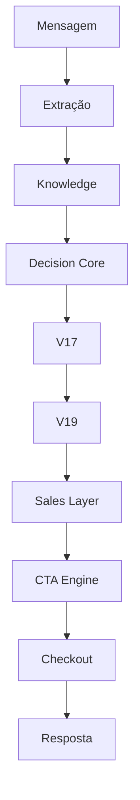

# 12_MAPA_DE_DECISOES.md

# Mapa de Decisões Arquiteturais (AS-IS)

**Versão:** 1.0
**Status:** Estado Atual (AS-IS)
**Objetivo:** Documentar todas as decisões realizadas pelo Link Mágico, quem as produz, quem as consome, onde existem sobreposições e quais são os principais riscos arquiteturais.

---

# 1. Objetivo

O Link Mágico evoluiu durante diversas versões arquiteturais (V10, V11, V12, V13, V14, V15, V16, V17, V18, V19 e V21).

Como consequência, diferentes módulos passaram a executar responsabilidades semelhantes.

Este documento identifica todas as decisões existentes no sistema e descreve:

* quem toma cada decisão;
* quem utiliza essa decisão;
* onde existem duplicações;
* onde existem conflitos de autoridade;
* quais pontos apresentam maior risco de regressão.

Este documento descreve apenas a arquitetura existente. Não propõe alterações.

---

# 2. Pipeline Global de Decisão

Fluxo simplificado observado durante a auditoria:

```text
Mensagem

↓

Normalização

↓

Extração

↓

Knowledge

↓

Decision Core

↓

Decision Engine

↓

V16

↓

V17

↓

V19

↓

Sales Layer

↓

CTA Engine

↓

Checkout

↓

Resposta
```

Nem todas essas etapas executam simultaneamente.

A execução depende das Feature Flags ativas.

---

# 3. Principais Tipos de Decisão

Durante a auditoria foram identificadas as seguintes categorias de decisão.

## Conversacionais

* intenção
* contexto
* estratégia
* tom
* buyer stage

---

## Comerciais

* CTA
* checkout
* urgência
* pressão comercial
* closing

---

## Técnicas

* links
* WhatsApp
* fallback
* Feature Flags
* canal

---

## Persistência

* CRM
* Lead
* Analytics
* Scheduler
* Billing

---

# 4. Decisão: Identificação de Intent

## Objetivo

Determinar o significado principal da mensagem.

---

## Produtores

* Decision Core
* Decision Engine
* V16
* V17
* V19

---

## Consumidores

* Orchestrator
* Sales Layer
* CTA Engine
* Closing Scripts
* Checkout Blocker
* Lead Capture
* Analytics

---

## Risco

Muito Alto.

Mais de um módulo pode produzir intents diferentes para a mesma mensagem.

---

# 5. Decisão: Estratégia Conversacional

Objetivo:

Definir como a IA responderá.

Inclui:

* tom;
* profundidade;
* persuasão;
* estratégia.

---

## Produtores

Principalmente:

* V17

Secundariamente:

* Sales Layer

---

## Consumidores

* Prompt Builder
* CTA
* Closing

---

## Risco

Médio.

---

# 6. Decisão: Buyer Stage

Objetivo:

Determinar o estágio do usuário.

---

## Produtores

* V17
* V19

---

## Consumidores

* CTA Engine
* Closing
* CRM

---

## Risco

Alto.

---

# 7. Decisão: CTA

Objetivo:

Definir se haverá chamada para ação.

---

## Produtores

* V17
* V19
* CTA Engine
* Sales Layer

---

## Consumidores

* Resposta Final
* Widget
* WhatsApp

---

## Observação

Durante a auditoria foi identificado que múltiplos módulos podem alterar o CTA.

---

# 8. Decisão: Checkout

Objetivo:

Selecionar o checkout mais adequado.

---

## Produtores

* Link Resolver
* V17 Link Resolver
* Checkout Authority
* Safe Checkout
* Force Checkout
* Checkout Fallback

---

## Consumidores

* Widget
* WhatsApp
* API

---

## Risco

Muito Alto.

Foi identificada sobreposição significativa.

---

# 9. Decisão: Resolução de Links

Objetivo:

Escolher o link final.

---

## Produtores

* Link Resolver
* V17 Link Resolver
* _resolveLink()

---

## Consumidores

* CTA
* Checkout
* Resposta

---

## Risco

Muito Alto.

---

# 10. Decisão: WhatsApp

Objetivo:

Selecionar contato.

---

## Produtores

* V18
* Link Resolver
* Extração

---

## Consumidores

* Widget
* CTA
* WhatsApp API

---

## Risco

Médio.

---

# 11. Decisão: Extração

Objetivo:

Extrair informações estruturadas.

---

## Produtores

* Deep Context Explorer
* Crawl
* Checkout Discovery
* V18

---

## Consumidores

* Knowledge
* V17
* V19

---

## Risco

Médio.

---

# 12. Decisão: Contexto

Objetivo:

Construir contexto.

---

## Produtores

* Knowledge
* Histórico
* CRM
* Extração

---

## Consumidores

* V17

---

## Risco

Baixo.

---

# 13. Decisão: Lead Capture

Objetivo:

Capturar leads.

---

## Produtores

* Widget
* Servidor
* Lead Capture Score

---

## Consumidores

* CRM
* Analytics

---

## Risco

Médio.

---

# 14. Decisão: Analytics

Objetivo:

Registrar métricas.

---

## Produtores

Todos os pipelines.

---

## Consumidores

* Dashboard
* Relatórios

---

## Risco

Baixo.

---

# 15. Decisão: Billing

Objetivo:

Controlar recursos.

---

## Produtores

Billing.

---

## Consumidores

Feature Flags.

---

## Risco

Baixo.

---

# 16. Mapa de Autoridade Observado

| Decisão     | Produtores Identificados                                         | Consumidores         |
| ----------- | ---------------------------------------------------------------- | -------------------- |
| Intent      | Decision Core, Decision Engine, V16, V17, V19                    | Sales, CTA, Checkout |
| Estratégia  | V17, Sales Layer                                                 | CTA                  |
| Buyer Stage | V17, V19                                                         | CTA                  |
| CTA         | V17, V19, CTA Engine                                             | Resposta             |
| Checkout    | Link Resolver, Checkout Authority, Safe Checkout, Force Checkout | Widget               |
| Links       | Link Resolver, V17 Link Resolver                                 | Checkout             |
| Extração    | V18                                                              | Knowledge            |
| Contexto    | Knowledge                                                        | V17                  |
| Lead        | Lead Capture                                                     | CRM                  |
| Analytics   | Analytics                                                        | Dashboard            |

---

# 17. Sobreposições Identificadas

Durante a auditoria foram confirmadas as seguintes sobreposições:

* múltiplos detectores de intent;
* múltiplos resolvedores de checkout;
* múltiplos resolvedores de links;
* múltiplos geradores de CTA;
* múltiplos pontos de captura de lead;
* múltiplos enriquecedores de contexto.

---

# 18. Pontos de Maior Risco

Os principais riscos arquiteturais concentram-se em:

1. Intent.
2. CTA.
3. Checkout.
4. Links.
5. Buyer Stage.

Esses elementos podem ser modificados por mais de um módulo durante a mesma execução.

---

# 19. Fluxo Simplificado das Decisões



---

# 20. Conclusão

A auditoria confirma que o Link Mágico possui uma arquitetura rica em mecanismos de decisão distribuídos.

Essa evolução trouxe flexibilidade e compatibilidade entre versões, porém aumentou significativamente o número de pontos capazes de modificar uma mesma decisão.

O principal desafio arquitetural atual não é a ausência de mecanismos de decisão, mas a coexistência de múltiplas autoridades sobre responsabilidades semelhantes.

Este documento registra o estado atual dessas decisões e servirá como base para os documentos de Matriz de Autoridade, Contratos Arquiteturais e Roadmap de Migração, que definirão a arquitetura-alvo do projeto.
