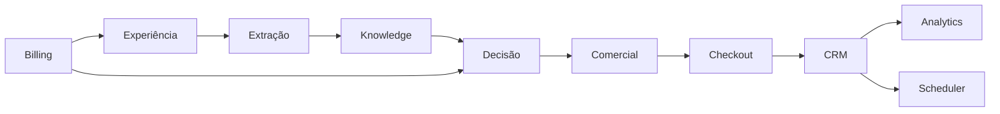

# 13_MODELO_DE_DOMINIOS.md

# Modelo de Domínios Arquiteturais (AS-IS)

**Versão:** 1.0
**Status:** Estado Atual (AS-IS)
**Objetivo:** Documentar os domínios funcionais do Link Mágico, suas responsabilidades, limites, dependências e interações, estabelecendo uma visão arquitetural baseada em domínios de negócio.

---

# 1. Objetivo

O Link Mágico deixou de ser apenas um chatbot e evoluiu para uma plataforma SaaS composta por diversos subsistemas especializados.

Cada conjunto de funcionalidades forma um domínio arquitetural próprio.

Este documento identifica esses domínios, suas responsabilidades e suas relações, sem propor alterações na implementação atual.

---

# 2. O que é um Domínio

Neste documento, um domínio representa um conjunto coeso de responsabilidades relacionadas a um mesmo contexto de negócio.

Cada domínio deve possuir:

* responsabilidade principal;
* limites claros;
* dados próprios;
* serviços próprios;
* consumidores definidos.

Idealmente, um domínio não deve assumir responsabilidades pertencentes a outro domínio.

---

# 3. Visão Geral dos Domínios

A auditoria identificou os seguintes domínios principais:

```text
Experiência do Usuário

Conversação

Conhecimento

Extração

Decisão

Comercial

Checkout

CRM

Analytics

Scheduler

Billing

Infraestrutura

Segurança

Multi-Tenant

Administração
```

---

# 4. Domínio de Experiência do Usuário

## Objetivo

Gerenciar toda a interação entre usuário e plataforma.

---

## Componentes

* Widget Inline
* Widget Fullscreen
* Link Curto
* API Pública
* Interface Administrativa

---

## Responsabilidades

* entrada de mensagens;
* renderização;
* captura de eventos;
* gerenciamento de sessão.

---

## Não deve decidir

* intenção;
* checkout;
* CTA;
* estratégia comercial.

---

# 5. Domínio Conversacional

## Objetivo

Controlar o fluxo de conversação.

---

## Componentes

* Pipeline Conversacional
* Context Builder
* Prompt Builder
* Orchestrator

---

## Responsabilidades

* organizar o fluxo;
* construir contexto;
* preparar entradas da IA;
* coordenar execução.

---

# 6. Domínio de Conhecimento

## Objetivo

Fornecer conhecimento para a IA.

---

## Fontes

* FAQ
* documentos
* páginas
* memória
* CRM
* contexto
* histórico

---

## Responsabilidades

* consolidar informações;
* enriquecer contexto;
* fornecer conhecimento.

---

# 7. Domínio de Extração

## Objetivo

Extrair informações estruturadas.

---

## Componentes

* Crawl
* Deep Context Explorer
* Checkout Discovery
* Checkout Click Discovery
* V18 Extraction Guard

---

## Responsabilidades

* descobrir checkout;
* descobrir WhatsApp;
* descobrir links;
* extrair contexto.

---

## Saída Esperada

```text
pageData
```

---

# 8. Domínio de Decisão

## Objetivo

Interpretar mensagens e produzir decisões.

---

## Componentes

* Decision Core
* Decision Engine
* V16
* V17
* V19

---

## Responsabilidades

* interpretar intenção;
* estratégia;
* buyer stage;
* decisões determinísticas.

---

## Observação

Este domínio apresenta o maior número de sobreposições identificadas na auditoria.

---

# 9. Domínio Comercial

## Objetivo

Converter decisões em ações comerciais.

---

## Componentes

* Sales Layer
* CTA Engine
* Closing Scripts

---

## Responsabilidades

* pressão comercial;
* urgência;
* CTA;
* fechamento.

---

## Não deveria

Reinterpretar decisões produzidas por domínios anteriores.

---

# 10. Domínio de Checkout

## Objetivo

Resolver o destino comercial da conversa.

---

## Componentes

* Link Resolver
* V17 Link Resolver
* Checkout Authority
* Safe Checkout
* Force Checkout
* Checkout Fallback

---

## Responsabilidades

* selecionar checkout;
* validar checkout;
* proteger checkout;
* resolver links.

---

## Observação

É um dos domínios com maior concentração de regras duplicadas.

---

# 11. Domínio CRM

## Objetivo

Persistir relacionamento com clientes.

---

## Responsabilidades

* leads;
* histórico;
* pipeline;
* contatos;
* oportunidades.

---

## Consumidores

* Dashboard;
* Analytics;
* Scheduler.

---

# 12. Domínio Analytics

## Objetivo

Registrar comportamento do sistema.

---

## Responsabilidades

* eventos;
* métricas;
* funil;
* indicadores;
* performance.

---

## Observação

Analytics observa o sistema.

Não deve alterar decisões.

---

# 13. Domínio Scheduler

## Objetivo

Executar tarefas assíncronas.

---

## Responsabilidades

* follow-up;
* lembretes;
* automações;
* execuções agendadas.

---

# 14. Domínio Billing

## Objetivo

Gerenciar assinatura da plataforma.

---

## Responsabilidades

* planos;
* pagamentos;
* limites;
* renovação.

---

## Influência

Billing controla acesso aos recursos, mas não participa da lógica conversacional.

---

# 15. Domínio Multi-Tenant

## Objetivo

Garantir isolamento entre clientes.

---

## Responsabilidades

* identificação;
* configuração;
* branding;
* Feature Flags;
* isolamento de dados.

---

## Importância

É um domínio transversal.

Todos os demais dependem dele.

---

# 16. Domínio de Segurança

## Objetivo

Garantir integridade da plataforma.

---

## Responsabilidades

* autenticação;
* autorização;
* validação;
* sanitização;
* isolamento.

---

## Componentes

* Login;
* Middleware;
* Guards;
* Sanitização.

---

# 17. Domínio Administrativo

## Objetivo

Gerenciar a operação da plataforma.

---

## Componentes

* Dashboard;
* Painel Administrativo;
* Configurações;
* Feature Flags.

---

## Responsabilidades

* configuração;
* monitoramento;
* manutenção.

---

# 18. Relação Entre os Domínios



---

# 19. Dependências Arquiteturais

| Domínio     | Depende de            |
| ----------- | --------------------- |
| Experiência | Multi-Tenant, Billing |
| Conversação | Knowledge             |
| Knowledge   | Extração              |
| Decisão     | Knowledge             |
| Comercial   | Decisão               |
| Checkout    | Comercial             |
| CRM         | Checkout              |
| Analytics   | CRM                   |
| Scheduler   | CRM                   |
| Billing     | Infraestrutura        |

---

# 20. Domínios Transversais

Alguns domínios atravessam praticamente toda a arquitetura.

São eles:

* Multi-Tenant;
* Segurança;
* Feature Flags;
* Observabilidade;
* Logging;
* Configuração.

Esses domínios não pertencem a um único pipeline.

---

# 21. Limites Arquiteturais Observados

Durante a auditoria foram identificados limites relativamente claros para a maioria dos domínios.

Entretanto, alguns apresentam sobreposição significativa.

Principais casos:

* Decisão ↔ Comercial;
* Comercial ↔ Checkout;
* Extração ↔ Checkout;
* CTA ↔ Estratégia;
* Link Resolver ↔ Checkout.

Esses pontos representam os maiores riscos arquiteturais do sistema.

---

# 22. Diagrama Geral dos Domínios

```text
Experiência

↓

Extração

↓

Knowledge

↓

Decisão

↓

Comercial

↓

Checkout

↓

CRM

↓

Analytics
```

Fluxos paralelos:

* Billing;
* Scheduler;
* Administração;
* Segurança;
* Multi-Tenant.

---

# 23. Conclusão

A arquitetura do Link Mágico encontra-se organizada em domínios relativamente bem definidos, refletindo sua evolução para uma plataforma SaaS completa.

A auditoria demonstra que a maioria das responsabilidades já está naturalmente agrupada em contextos específicos, porém alguns domínios — especialmente Decisão, Comercial e Checkout — apresentam interseções relevantes que justificam atenção em futuras iniciativas de governança arquitetural.

Este modelo de domínios fornece uma visão sistêmica da plataforma e servirá como base para a Matriz de Autoridade, os Contratos Arquiteturais e futuras evoluções do projeto.
