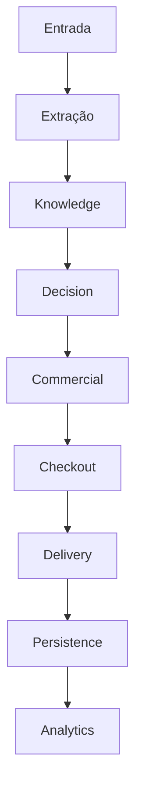
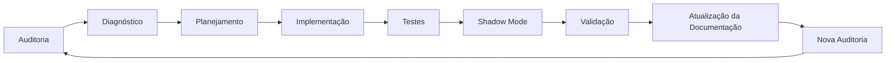
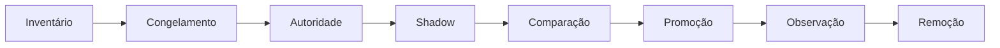

# 14_ARQUITETURA_ALVO.md

# Arquitetura Alvo (TO-BE)

**Versão:** 1.0
**Status:** Arquitetura Alvo (TO-BE)
**Objetivo:** Definir a arquitetura de referência para a evolução do Link Mágico, estabelecendo princípios, responsabilidades, contratos e limites entre módulos, reduzindo sobreposições, eliminando ambiguidades de autoridade e minimizando regressões futuras.

---

# Parte 1 — Visão Arquitetural, Princípios Fundamentais e Objetivos

## 1. Objetivo

Este documento não descreve o funcionamento atual do sistema.

Seu propósito é estabelecer a arquitetura desejada para a evolução do Link Mágico ao longo das próximas versões, definindo um conjunto de princípios permanentes de engenharia que orientarão toda modificação futura da plataforma.

Enquanto os documentos AS-IS descrevem como o sistema realmente funciona hoje, este documento define como ele deverá funcionar quando o processo de convergência arquitetural estiver concluído.

---

# 2. Contexto

A auditoria arquitetural realizada sobre o Link Mágico identificou um padrão recorrente de crescimento incremental.

Ao longo da evolução do projeto, novos módulos foram adicionados para resolver problemas específicos, frequentemente preservando compatibilidade com versões anteriores.

Essa estratégia permitiu rápida evolução funcional, porém introduziu um efeito colateral importante:

múltiplos componentes passaram a executar responsabilidades equivalentes simultaneamente.

Como consequência, uma única mensagem pode ser analisada, reinterpretada e modificada por diversos motores independentes antes da resposta final ser produzida.

Esse comportamento aumenta significativamente a complexidade do sistema e eleva o risco de regressões.

---

# 3. Visão da Arquitetura Alvo

A arquitetura alvo parte de um princípio simples:

Cada responsabilidade de negócio deverá possuir uma única autoridade.

Essa autoridade será responsável por produzir a decisão correspondente.

Todos os demais módulos deverão apenas consumir essa decisão.

Nenhum consumidor poderá reinterpretar, substituir ou recriar decisões já produzidas pela autoridade responsável, exceto quando existir contrato arquitetural explícito autorizando tal comportamento.

---

# 4. Objetivos Estratégicos

A arquitetura alvo busca atingir os seguintes objetivos:

* reduzir regressões;
* eliminar duplicações de responsabilidade;
* tornar decisões previsíveis;
* simplificar manutenção;
* facilitar testes;
* permitir evolução incremental;
* preservar compatibilidade com clientes existentes;
* reduzir acoplamento entre módulos;
* facilitar auditorias futuras.

---

# 5. Princípios Fundamentais

## 5.1 Responsabilidade Única

Cada módulo deverá possuir apenas uma responsabilidade principal.

Sempre que um componente executar responsabilidades pertencentes a outro domínio, essa situação deverá ser considerada dívida arquitetural.

---

## 5.2 Autoridade Única

Toda decisão relevante deverá possuir exatamente um proprietário.

Exemplos:

* intenção;
* CTA;
* checkout;
* estratégia comercial;
* resolução de links;
* extração.

A autoridade produz.

Os demais módulos consomem.

---

## 5.3 Consumidores Não Decidem

Um consumidor poderá:

* utilizar;
* validar;
* enriquecer;
* registrar;
* monitorar;

uma decisão produzida anteriormente.

Entretanto, não deverá alterá-la silenciosamente.

Caso seja necessária uma nova decisão, ela deverá retornar ao módulo responsável pela autoridade correspondente.

---

## 5.4 Camadas Independentes

Os domínios arquiteturais deverão permanecer independentes.

Mudanças em um domínio não deverão produzir efeitos colaterais inesperados em outro.

---

## 5.5 Compatibilidade Progressiva

Toda evolução deverá ocorrer de forma incremental.

Durante a migração:

* versões antigas poderão coexistir;
* Feature Flags controlarão ativações;
* Shadow Mode será priorizado;
* Rollback deverá ser simples.

---

# 6. Modelo Conceitual

A arquitetura alvo organiza o sistema em domínios especializados.

```text
Entrada

↓

Extração

↓

Conhecimento

↓

Decisão

↓

Comercial

↓

Checkout

↓

Entrega

↓

Persistência

↓

Analytics
```

Cada domínio possui limites claros.

Nenhum domínio deverá invadir responsabilidades do seguinte.

---

# 7. Fluxo Conceitual

O fluxo lógico deverá obedecer sempre à mesma sequência.

```text
Mensagem

↓

Extração

↓

Knowledge

↓

Intent

↓

Estratégia

↓

CTA

↓

Checkout

↓

Resposta

↓

Persistência

↓

Analytics
```

Uma etapa consome exclusivamente a saída da etapa anterior.

---

# 8. Princípio da Imutabilidade das Decisões

Após uma decisão ser oficialmente produzida por sua autoridade:

* ela não poderá ser recriada;
* não poderá ser reinterpretada;
* não poderá ser sobrescrita silenciosamente.

Caso alguma inconsistência seja detectada posteriormente, o consumidor poderá:

* registrar;
* validar;
* bloquear;
* solicitar nova decisão.

Jamais produzir uma decisão paralela.

---

# 9. Arquitetura Baseada em Contratos

Toda comunicação entre domínios deverá ocorrer através de contratos explícitos.

Cada contrato deverá definir:

* entradas;
* saídas;
* responsabilidades;
* garantias;
* limitações.

Isso reduz dependências implícitas e facilita a evolução da plataforma.

---

# 10. Governança por Domínio

Cada domínio possuirá uma autoridade claramente definida.

Exemplos conceituais:

| Domínio      | Autoridade         |
| ------------ | ------------------ |
| Extração     | Engine de Extração |
| Conhecimento | Knowledge Engine   |
| Decisão      | Unified Brain      |
| Comercial    | Motor Comercial    |
| Checkout     | Checkout Authority |
| CRM          | CRM                |
| Billing      | Billing            |
| Scheduler    | Scheduler          |
| Analytics    | Analytics          |

Essas autoridades representam contratos arquiteturais e não necessariamente correspondem a uma implementação específica existente hoje.

---

# 11. Princípio do Single Source of Truth

Cada informação relevante deverá possuir apenas uma fonte oficial.

Exemplos:

* intenção → uma única origem;
* CTA → uma única origem;
* checkout → uma única origem;
* estratégia → uma única origem;
* buyer stage → uma única origem.

Consumidores jamais deverão recalcular informações já disponíveis.

---

# 12. Arquitetura Orientada a Evolução

O crescimento futuro deverá ocorrer pela adição de novos módulos especializados.

Não pela multiplicação de módulos que executam a mesma responsabilidade.

Sempre que uma nova funcionalidade exigir uma decisão arquitetural, a primeira pergunta deverá ser:

"Já existe uma autoridade responsável por esta decisão?"

Se a resposta for positiva, a funcionalidade deverá integrar-se à autoridade existente, evitando duplicação de lógica.

---

# 13. Critérios de Sucesso

A arquitetura alvo será considerada atingida quando:

* cada responsabilidade possuir exatamente uma autoridade;
* não existirem decisões concorrentes;
* Feature Flags controlarem apenas evolução, não conflitos;
* regressões cruzadas forem significativamente reduzidas;
* novos módulos puderem ser adicionados sem alterar contratos existentes.

---

# 14. Conclusão da Parte 1

Esta arquitetura estabelece uma mudança de paradigma.

O objetivo deixa de ser apenas adicionar funcionalidades e passa a ser preservar coerência arquitetural.

Os próximos capítulos detalharão:

* o modelo de autoridade;
* os domínios especializados;
* os contratos entre módulos;
* a arquitetura em camadas;
* os princípios de governança;
* o fluxo único de decisão;
* a estratégia de convergência entre o estado atual (AS-IS) e a arquitetura alvo (TO-BE).

Este documento servirá como referência normativa para toda evolução futura do Link Mágico.

# Parte 2 — Modelo de Autoridade Arquitetural

---

# 15. Princípio da Autoridade Única

O principal objetivo da arquitetura alvo é eliminar decisões concorrentes.

Para isso, toda responsabilidade funcional da plataforma deverá possuir exatamente uma autoridade arquitetural.

Autoridade significa o componente oficialmente responsável por produzir determinada decisão.

Nenhum outro módulo poderá recriar, reinterpretar ou substituir essa decisão sem um contrato arquitetural explícito.

---

# 16. O que é uma Autoridade

Uma autoridade arquitetural é o único componente autorizado a responder uma pergunta específica do sistema.

Exemplos:

Quem determina a intenção da mensagem?

Quem decide se haverá CTA?

Quem escolhe o checkout?

Quem define o estágio do comprador?

Quem resolve um link?

Quem extrai o WhatsApp?

Cada uma dessas perguntas deverá possuir apenas uma resposta oficial.

---

# 17. Papéis Arquiteturais

Todo componente da plataforma deverá exercer apenas um dos seguintes papéis.

## Autoridade

Produz decisões.

Pode alterar estado.

Pode definir comportamento.

É responsável pelo contrato.

---

## Consumidor

Recebe decisões.

Executa comportamento.

Nunca altera decisões.

Nunca produz uma nova versão da decisão recebida.

---

## Validador

Confirma integridade.

Executa regras de segurança.

Pode bloquear execução.

Não cria decisões alternativas.

---

## Observador

Registra.

Audita.

Produz métricas.

Não interfere no fluxo.

---

## Executor

Executa ações físicas.

Enviar WhatsApp.

Salvar Lead.

Enviar Email.

Persistir CRM.

Não interpreta regras de negócio.

---

# 18. Exemplo Conceitual

Fluxo incorreto.

```text
V17 decide BUY

↓

V19 muda para PRICE

↓

Sales muda para INTEREST

↓

Checkout Authority injeta CTA

↓

Force Checkout troca checkout
```

Cada módulo altera o anterior.

Resultado:

não existe uma decisão oficial.

---

Fluxo desejado.

```text
V17

↓

produz decisão

↓

V19 valida

↓

Sales consome

↓

Checkout consome

↓

Resposta
```

A decisão permanece única.

---

# 19. Modelo Geral de Autoridade

A arquitetura alvo organiza o sistema em domínios independentes.

Cada domínio possui exatamente um responsável.

```text
Extração

↓

Conhecimento

↓

Decisão

↓

Comercial

↓

Checkout

↓

Entrega

↓

Persistência

↓

Analytics
```

Cada domínio publica informações.

O domínio seguinte apenas consome.

---

# 20. Autoridade da Extração

Responsabilidade:

descobrir informações externas.

Inclui:

checkout

WhatsApp

redes sociais

links

conteúdo

texto

metadados

---

Consumidores.

Knowledge.

CRM.

Analytics.

---

Nunca deverá:

decidir CTA.

decidir venda.

produzir intenção.

---

# 21. Autoridade do Conhecimento

Responsabilidade.

Construir contexto.

Consolidar memória.

Selecionar documentos.

Preparar conhecimento para IA.

---

Consumidores.

Unified Brain.

Analytics.

CRM.

---

Não deverá:

decidir estratégia.

decidir checkout.

---

# 22. Autoridade da Decisão

Responsabilidade.

Interpretar a intenção da conversa.

Produzir:

Intent

Buyer Stage

Confidence

Sell Mode

Tone

Need Human

Need Checkout

Need CTA

---

Essa é a decisão oficial da conversa.

Nenhum outro domínio deverá recalcular essas informações.

---

# 23. Autoridade Comercial

Responsabilidade.

Transformar decisões em estratégia comercial.

Produzir:

pressão

urgência

copy

CTA textual

ordem de argumentos

sequência de persuasão

---

Não interpreta intenção.

Recebe intenção.

---

# 24. Autoridade de Checkout

Responsabilidade.

Selecionar o destino comercial.

Resolver:

checkout

WhatsApp

fallback

priorização

links

---

Não deverá:

decidir venda.

decidir CTA.

decidir intenção.

---

# 25. Autoridade de Persistência

Responsabilidade.

Salvar.

Atualizar.

Sincronizar.

Nunca interpretar.

Nunca decidir.

---

Inclui.

CRM.

Banco.

Histórico.

Lead.

Scheduler.

---

# 26. Autoridade de Analytics

Responsabilidade.

Observar.

Medir.

Aprender.

Gerar indicadores.

---

Nunca modificar comportamento da conversa.

Analytics observa.

Não controla.

---

# 27. Autoridade de Billing

Responsabilidade.

Determinar permissões.

Planos.

Limites.

Assinaturas.

---

Billing controla acesso.

Não participa da conversa.

---

# 28. Autoridade Multi-Tenant

Responsabilidade.

Garantir isolamento.

Cada tenant possui.

Configuração.

Branding.

Feature Flags.

Conhecimento.

CRM.

Analytics.

Separados.

---

# 29. Autoridade de Segurança

Responsabilidade.

Autenticação.

Autorização.

Sanitização.

Validação.

Proteção.

---

Nunca alterar decisões comerciais.

---

# 30. Autoridades Transversais

Existem componentes que atravessam toda a arquitetura.

Feature Flags.

Logs.

Observabilidade.

Monitoramento.

Tracing.

Esses componentes não possuem autoridade funcional.

Eles apenas suportam os demais domínios.

---

# 31. Modelo de Publicação

Cada autoridade publica um contrato.

Exemplo.

```text
DecisionResult

{

intent,

buyerStage,

sellMode,

confidence,

ctaAllowed,

checkoutAllowed

}
```

Esse objeto passa a ser imutável.

---

# 32. Modelo de Consumo

Todos os consumidores utilizam o mesmo contrato.

```text
DecisionResult

↓

Sales

↓

Checkout

↓

CRM

↓

Analytics
```

Nenhum consumidor altera DecisionResult.

---

# 33. Proibição de Reinterpretação

É proibido que um consumidor faça algo semelhante a:

```text
Se intent == INFO

↓

transformar em BUY

↓

continuar fluxo
```

Esse comportamento cria decisões concorrentes.

Caso uma nova interpretação seja necessária, ela deverá retornar à autoridade responsável.

---

# 34. Cadeia Oficial de Autoridade

A arquitetura alvo estabelece uma sequência única de produção de decisões.

```text
Mensagem

↓

Extração

↓

Knowledge

↓

Decision

↓

Commercial

↓

Checkout

↓

Delivery

↓

Persistence

↓

Analytics
```

Cada etapa produz apenas aquilo que lhe pertence.

---

# 35. Benefícios Esperados

A adoção desse modelo proporciona:

eliminação de decisões paralelas;

redução de regressões;

maior previsibilidade;

facilidade de testes;

isolamento entre módulos;

maior clareza arquitetural;

evolução incremental mais segura.

---

# 36. Conclusão da Parte 2

O conceito de Autoridade Arquitetural constitui o núcleo da arquitetura alvo do Link Mágico.

A partir dele, todas as responsabilidades deixam de ser distribuídas entre múltiplos motores concorrentes e passam a possuir um único proprietário oficial.

Os próximos capítulos detalharão como essas autoridades se organizam em camadas, como se comunicam por contratos e como o sistema pode convergir gradualmente da arquitetura atual para esse modelo, preservando compatibilidade e reduzindo riscos de regressão.

# Parte 3 — Arquitetura em Camadas (Layered Architecture)

---

# 37. Objetivo da Arquitetura em Camadas

Uma das principais conclusões da auditoria arquitetural foi que diversos módulos executam responsabilidades pertencentes a camadas diferentes.

Essa mistura dificulta:

* manutenção;
* testes;
* evolução;
* auditoria;
* identificação de regressões.

A arquitetura alvo estabelece uma separação rigorosa entre camadas.

Cada camada possui uma única missão.

---

# 38. Modelo Geral

A arquitetura futura será organizada da seguinte forma.

```text
──────────────────────────────
Camada 1
Entrada
──────────────────────────────

↓

──────────────────────────────
Camada 2
Extração
──────────────────────────────

↓

──────────────────────────────
Camada 3
Conhecimento
──────────────────────────────

↓

──────────────────────────────
Camada 4
Decisão
──────────────────────────────

↓

──────────────────────────────
Camada 5
Estratégia Comercial
──────────────────────────────

↓

──────────────────────────────
Camada 6
Checkout
──────────────────────────────

↓

──────────────────────────────
Camada 7
Entrega
──────────────────────────────

↓

──────────────────────────────
Camada 8
Persistência
──────────────────────────────

↓

──────────────────────────────
Camada 9
Analytics
──────────────────────────────
```

Cada camada comunica-se apenas com a imediatamente seguinte.

---

# 39. Camada de Entrada

## Objetivo

Receber mensagens provenientes dos diversos canais.

---

## Componentes

* Widget Inline
* Widget Fullscreen
* WhatsApp
* API
* Link Curto
* CRM
* Scheduler

---

## Responsabilidades

Receber mensagens.

Validar formato.

Identificar Tenant.

Criar contexto inicial.

Abrir sessão.

---

## Não pode

Interpretar intenção.

Escolher checkout.

Gerar CTA.

Tomar decisões comerciais.

---

# 40. Camada de Extração

## Objetivo

Descobrir informações externas.

---

## Responsabilidades

Extrair:

* checkout;
* WhatsApp;
* links;
* redes sociais;
* páginas;
* conteúdo;
* metadados.

---

## Componentes

* Crawl
* Discovery
* V18
* Deep Explorer

---

## Saída

```text
ExtractionResult
```

---

## Não pode

Criar CTA.

Interpretar intenção.

Modificar estratégia.

---

# 41. Camada de Conhecimento

## Objetivo

Construir conhecimento disponível para a IA.

---

## Entradas

ExtractionResult

Histórico.

Memória.

CRM.

FAQ.

Base documental.

---

## Saída

```text
KnowledgeContext
```

---

## Responsabilidades

Selecionar documentos.

Eliminar redundâncias.

Organizar contexto.

Preparar prompt.

---

## Não pode

Produzir decisão.

Gerar checkout.

---

# 42. Camada de Decisão

Esta é a camada mais importante da arquitetura.

Ela representa o cérebro do sistema.

---

## Responsabilidades

Classificar intenção.

Buyer Stage.

Confidence.

Tone.

Need Human.

Need Checkout.

Need CTA.

Urgência.

Modo de venda.

---

## Saída

```text
DecisionResult
```

---

## Regra

Nenhuma outra camada poderá recalcular essas informações.

---

# 43. Camada Comercial

Recebe exclusivamente DecisionResult.

Jamais analisa novamente a mensagem original.

---

## Responsabilidades

Construir estratégia.

Selecionar abordagem.

Produzir copy.

Definir CTA textual.

Escolher sequência de argumentos.

---

## Saída

```text
CommercialStrategy
```

---

## Não pode

Criar nova intenção.

Modificar buyer stage.

Modificar checkout.

---

# 44. Camada de Checkout

Recebe:

DecisionResult.

CommercialStrategy.

ExtractionResult.

---

## Responsabilidades

Selecionar checkout.

Escolher WhatsApp.

Resolver links.

Executar fallback.

Validar domínio.

Validar tenant.

---

## Saída

```text
CheckoutResult
```

---

## Não pode

Alterar intenção.

Modificar CTA.

Produzir estratégia.

---

# 45. Camada de Entrega

Recebe todos os contratos anteriores.

---

## Responsabilidades

Montar resposta.

Aplicar template.

Inserir CTA.

Inserir checkout.

Responder usuário.

---

## Não interpreta regras.

Executa.

---

# 46. Camada de Persistência

Executa gravações.

CRM.

Lead.

Banco.

Scheduler.

Histórico.

Eventos.

---

## Nunca modifica decisões.

---

# 47. Camada de Analytics

Recebe eventos.

Mede comportamento.

Calcula indicadores.

Produz dashboards.

Aprende padrões.

---

Analytics nunca interfere na conversa.

---

# 48. Camadas Transversais

Alguns serviços atravessam todas as camadas.

São eles.

Multi-Tenant.

Billing.

Segurança.

Feature Flags.

Logs.

Tracing.

Observabilidade.

Esses componentes fornecem infraestrutura.

Não fazem parte do fluxo de decisão.

---

# 49. Dependências Permitidas

Uma camada poderá depender apenas de:

a camada imediatamente anterior;

contratos públicos;

componentes transversais.

---

## Dependências proibidas

Extração acessar Checkout.

Checkout acessar Knowledge.

Analytics alterar Decision.

CRM alterar CTA.

Sales alterar Intent.

---

# 50. Comunicação Entre Camadas

Toda comunicação ocorrerá por objetos imutáveis.

Exemplo.

```text
ExtractionResult

↓

KnowledgeContext

↓

DecisionResult

↓

CommercialStrategy

↓

CheckoutResult

↓

ResponsePayload
```

Cada contrato representa uma fronteira arquitetural.

---

# 51. Benefícios

Separação clara de responsabilidades.

Baixo acoplamento.

Maior testabilidade.

Maior previsibilidade.

Redução de regressões.

Evolução incremental.

Facilidade para auditorias.

Maior observabilidade.

---

# 52. Relação com a Arquitetura Atual

Na arquitetura existente, diversas camadas encontram-se parcialmente sobrepostas.

Exemplos identificados na auditoria:

* módulos de decisão executando lógica comercial;
* módulos comerciais reinterpretando intenção;
* resolvedores de checkout recalculando estratégia;
* pipelines paralelos produzindo decisões concorrentes.

A arquitetura alvo elimina essas sobreposições por meio da definição explícita de fronteiras entre camadas.

---

# 53. Diagrama Geral



---

# 54. Conclusão da Parte 3

A arquitetura em camadas estabelece uma estrutura previsível para toda a plataforma.

Cada camada possui responsabilidades exclusivas, comunica-se por contratos bem definidos e evita a propagação de regras de negócio para módulos que não são seus proprietários.

Essa organização reduz drasticamente a possibilidade de decisões concorrentes e fornece uma base sólida para a convergência gradual entre a arquitetura atual e a arquitetura alvo descrita neste documento.

# Parte 4 — Modelo de Contratos Entre Domínios

---

# 55. Objetivo

A arquitetura alvo adota um modelo baseado em contratos.

Nenhum domínio deverá conhecer detalhes internos de outro domínio.

Toda comunicação deverá ocorrer exclusivamente através de contratos públicos, estáveis e versionáveis.

Essa abordagem reduz acoplamento, facilita testes, permite evolução incremental e elimina dependências implícitas entre módulos.

---

# 56. O que é um Contrato Arquitetural

Um contrato representa o acordo oficial entre dois domínios.

Ele define:

* entradas;
* saídas;
* responsabilidades;
* garantias;
* limitações.

Um contrato nunca descreve como uma decisão é produzida.

Ele apenas define o que é entregue ao consumidor.

---

# 57. Regras Gerais

Todo contrato deverá obedecer aos seguintes princípios.

* Imutável.
* Versionável.
* Determinístico.
* Documentado.
* Compatível com versões anteriores sempre que possível.

Nenhum consumidor poderá modificar um contrato recebido.

---

# 58. Cadeia Oficial de Contratos

```text id="n5z8gh"
MessageInput

↓

ExtractionResult

↓

KnowledgeContext

↓

DecisionResult

↓

CommercialStrategy

↓

CheckoutResult

↓

ResponsePayload

↓

PersistenceEvent

↓

AnalyticsEvent
```

Cada contrato pertence exclusivamente a um domínio.

---

# 59. Contrato de Entrada

## Objetivo

Representar a mensagem recebida pela plataforma.

---

## Responsável

Camada de Entrada.

---

## Exemplo conceitual

```text id="b1qk6r"
MessageInput

tenant

channel

session

message

timestamp

metadata
```

---

## Consumidores

Extração.

Knowledge.

Logs.

---

# 60. Contrato de Extração

## Objetivo

Publicar todas as informações descobertas durante a etapa de extração.

---

## Exemplo

```text id="r0h1ys"
ExtractionResult

checkout

whatsapp

socials

links

emails

phones

pageData

confidence

source
```

---

## Responsável

Domínio de Extração.

---

## Consumidores

Knowledge.

Checkout.

Analytics.

CRM.

---

## Proibição

Nenhum consumidor poderá alterar informações extraídas.

---

# 61. Contrato de Conhecimento

Representa todo conhecimento consolidado disponível para a IA.

---

## Conteúdo

```text id="x4jg9w"
KnowledgeContext

documents

faq

memory

crmHistory

pageData

knowledgeBase

conversationHistory
```

---

## Responsável

Knowledge Engine.

---

## Consumidores

Unified Brain.

Analytics.

---

# 62. Contrato de Decisão

Este é o contrato mais importante da arquitetura.

---

## Exemplo

```text id="b7pc2e"
DecisionResult

intent

buyerStage

tone

sellMode

confidence

allowCTA

allowCheckout

needHuman

priority

riskLevel
```

---

## Responsável

Motor oficial de decisão.

---

## Consumidores

Sales.

Checkout.

CRM.

Analytics.

Resposta.

---

## Regra

Nenhum consumidor recalcula DecisionResult.

---

# 63. Contrato Comercial

Representa exclusivamente estratégia comercial.

---

## Exemplo

```text id="w2ns5k"
CommercialStrategy

approach

urgency

copy

arguments

ctaStyle

pressureLevel

closingStrategy
```

---

## Responsável

Domínio Comercial.

---

## Consumidores

Checkout.

Delivery.

---

# 64. Contrato de Checkout

Responsável por publicar o destino comercial.

---

## Exemplo

```text id="g8mv0a"
CheckoutResult

checkout

whatsapp

fallback

priority

channel

validation

safe

confidence
```

---

## Responsável

Checkout Authority.

---

## Consumidores

Delivery.

CRM.

Analytics.

---

# 65. Contrato de Resposta

Representa exatamente aquilo que será enviado ao usuário.

---

## Exemplo

```text id="t9fd3p"
ResponsePayload

text

cta

buttons

checkout

attachments

metadata
```

---

## Responsável

Delivery Layer.

---

## Consumidores

Widget.

WhatsApp.

API.

Link Curto.

---

# 66. Contrato de Persistência

Representa eventos gravados.

---

## Exemplo

```text id="j1mq6z"
PersistenceEvent

lead

crm

history

conversation

scheduler

logs
```

---

## Responsável

Persistência.

---

## Consumidores

Banco.

CRM.

Scheduler.

---

# 67. Contrato de Analytics

Representa métricas produzidas.

---

## Exemplo

```text id="m8tx4d"
AnalyticsEvent

intent

conversion

latency

confidence

checkoutUsed

tenant

channel
```

---

## Responsável

Analytics.

---

## Consumidores

Dashboard.

Admin.

Machine Learning.

---

# 68. Compatibilidade Entre Contratos

Os contratos deverão permanecer compatíveis entre versões.

Mudanças incompatíveis deverão ocorrer apenas mediante:

* nova versão;
* Feature Flag;
* migração planejada.

---

# 69. Versionamento

Todo contrato deverá possuir versão explícita.

Exemplo.

```text id="h3vw7r"
DecisionResult

version

2.0
```

Isso permite evolução gradual sem quebrar consumidores antigos.

---

# 70. Evolução dos Contratos

Novos campos poderão ser adicionados.

Campos existentes não deverão mudar significado.

Campos removidos deverão seguir política formal de depreciação.

---

# 71. Validação

Todo contrato deverá ser validado antes de ser publicado.

Exemplos.

DecisionResult deve possuir intent válida.

CheckoutResult deve conter checkout seguro.

KnowledgeContext não poderá conter referências inválidas.

---

# 72. Observabilidade

Toda publicação de contrato poderá gerar evento de observabilidade.

Exemplo.

```text id="r7lk0q"
DecisionResult publicado

↓

Log

↓

Trace

↓

Analytics
```

A observabilidade registra.

Nunca modifica.

---

# 73. Contratos Nunca Produzem Efeitos Colaterais

Publicar um contrato não deverá:

executar checkout;

salvar CRM;

enviar WhatsApp;

criar CTA.

Essas responsabilidades pertencem aos consumidores.

---

# 74. Benefícios

A utilização de contratos proporciona:

baixo acoplamento;

alta previsibilidade;

versionamento simples;

isolamento entre domínios;

facilidade de testes;

maior estabilidade;

redução de regressões.

---

# 75. Conclusão da Parte 4

A arquitetura baseada em contratos transforma a comunicação entre domínios em interfaces explícitas, estáveis e auditáveis.

Cada domínio passa a publicar apenas aquilo que lhe compete, enquanto os consumidores executam suas funções utilizando exclusivamente essas interfaces públicas.

Esse modelo reduz dependências implícitas, facilita a evolução da plataforma e estabelece a base necessária para uma arquitetura orientada por governança, autoridade única e responsabilidade claramente definida.

# Parte 5 — Governança Arquitetural e Processo de Evolução

---

# 76. Objetivo

A arquitetura alvo não depende apenas de uma boa divisão de módulos.

Ela depende principalmente de governança.

Sem regras claras de evolução, qualquer arquitetura tende novamente à sobreposição de responsabilidades, duplicação de lógica e aumento gradual da complexidade.

Este capítulo estabelece as regras permanentes de evolução do Link Mágico.

---

# 77. O Conceito de Governança

Governança arquitetural representa o conjunto de princípios que garantem que toda evolução preserve a coerência do sistema.

Ela define:

* quem pode decidir;
* como novos módulos são criados;
* como responsabilidades são atribuídas;
* como mudanças são aprovadas;
* como regressões são evitadas.

---

# 78. Objetivos da Governança

A governança possui cinco objetivos principais.

* preservar a arquitetura;
* reduzir regressões;
* facilitar auditorias;
* garantir previsibilidade;
* permitir crescimento contínuo.

---

# 79. Princípio da Evolução Incremental

Toda alteração deverá ser incremental.

Mudanças grandes deverão ser divididas em pequenas entregas independentes.

Cada etapa deverá possuir:

* objetivo único;
* impacto limitado;
* rollback simples;
* validação isolada.

---

# 80. Princípio da Compatibilidade

A evolução da plataforma deverá preservar compatibilidade sempre que possível.

Mudanças incompatíveis deverão ser planejadas previamente.

Nunca deverão ocorrer de forma silenciosa.

---

# 81. Feature Flags

Toda funcionalidade nova deverá nascer protegida por Feature Flag.

A Feature Flag deverá permitir:

* ativação gradual;
* Shadow Mode;
* rollback imediato;
* comparação entre versões.

---

# 82. Shadow Mode

Sempre que um novo motor substituir outro, deverá existir uma fase intermediária.

```text id="m2kt61"
Motor Antigo

↓

Produção

Motor Novo

↓

Shadow

↓

Logs

↓

Comparação

↓

Ativação
```

O novo motor observa.

Não altera comportamento.

---

# 83. Processo de Evolução

Nenhuma alteração deverá seguir diretamente para produção.

Fluxo obrigatório.

```text id="cz7m1n"
Diagnóstico

↓

Documentação

↓

Plano

↓

Aprovação

↓

Implementação

↓

Testes

↓

Shadow

↓

Validação

↓

Produção
```

---

# 84. Critérios para Novos Módulos

Antes da criação de qualquer módulo deverá ser respondido:

Existe outro módulo que já realiza essa responsabilidade?

Existe uma autoridade oficial?

Existe contrato arquitetural disponível?

Há Feature Flag planejada?

Existe plano de rollback?

Caso qualquer resposta seja negativa, a implementação deverá ser reavaliada.

---

# 85. Criação de Novas Responsabilidades

Nenhuma nova responsabilidade poderá ser criada sem atualização dos documentos de arquitetura.

Deverão ser atualizados:

* Matriz de Autoridade;
* Contratos Arquiteturais;
* Modelo de Domínios;
* Roadmap de Migração.

---

# 86. Alteração de Responsabilidades

Mover uma responsabilidade entre módulos é considerado um evento arquitetural.

Essa alteração deverá conter:

* justificativa;
* impacto esperado;
* consumidores afetados;
* estratégia de migração;
* estratégia de rollback.

---

# 87. Critérios para Aprovação

Uma alteração somente poderá ser aprovada quando demonstrar:

* responsabilidade única;
* ausência de duplicação;
* compatibilidade;
* cobertura por testes;
* documentação atualizada.

---

# 88. Critérios de Rejeição

Uma alteração deverá ser rejeitada quando:

* duplicar lógica existente;
* criar nova autoridade concorrente;
* alterar comportamento silenciosamente;
* eliminar rollback;
* ignorar contratos arquiteturais.

---

# 89. Processo de Auditoria

Auditorias arquiteturais deverão ocorrer periodicamente.

Objetivos:

* localizar duplicações;
* identificar responsabilidades sobrepostas;
* detectar novos acoplamentos;
* revisar contratos;
* validar autoridades.

---

# 90. Dívida Arquitetural

Toda exceção à arquitetura deverá ser registrada.

Cada dívida deverá possuir:

* descrição;
* motivação;
* impacto;
* risco;
* prioridade;
* plano de remoção.

---

# 91. ADRs (Architecture Decision Records)

Toda decisão estrutural relevante deverá gerar um ADR.

Cada ADR deverá responder:

Por que esta decisão foi tomada?

Quais alternativas foram avaliadas?

Quais riscos existem?

Como reverter?

Quais documentos foram impactados?

---

# 92. Versionamento Arquitetural

A arquitetura também deverá possuir versões.

Exemplo.

```text id="q3xh7p"
Arquitetura

1.0

↓

1.1

↓

2.0
```

Isso permite rastrear a evolução da plataforma ao longo do tempo.

---

# 93. Indicadores de Saúde Arquitetural

A governança deverá acompanhar indicadores como:

* número de autoridades por responsabilidade;
* quantidade de Feature Flags temporárias;
* duplicações identificadas;
* contratos desatualizados;
* módulos legados;
* dívidas arquiteturais abertas;
* regressões por versão.

---

# 94. Critério de Conclusão de Migração

Uma migração somente será considerada concluída quando:

* a autoridade antiga deixar de produzir decisões;
* todos os consumidores utilizarem a nova autoridade;
* Shadow Mode indicar convergência;
* testes demonstrarem equivalência funcional;
* documentação for atualizada.

---

# 95. Evolução Contínua

A arquitetura alvo não é estática.

Ela deverá evoluir continuamente.

Entretanto, toda evolução deverá preservar:

* responsabilidade única;
* autoridade única;
* contratos públicos;
* separação entre domínios;
* baixo acoplamento.

---

# 96. Princípio da Documentação Obrigatória

Nenhuma mudança arquitetural deverá existir apenas no código.

Toda alteração deverá ser refletida na documentação oficial.

A documentação torna-se parte integrante da arquitetura.

---

# 97. Relação entre Código e Documentação

Em caso de divergência:

* o código representa o comportamento atual;
* a documentação AS-IS descreve esse comportamento;
* a Arquitetura Alvo representa o comportamento desejado.

Esses três estados deverão permanecer claramente diferenciados.

---

# 98. Ciclo Permanente de Governança



---

# 99. Benefícios Esperados

A adoção deste modelo de governança permitirá:

* crescimento previsível da plataforma;
* redução contínua de regressões;
* maior estabilidade operacional;
* facilidade de onboarding de novos desenvolvedores;
* auditorias mais objetivas;
* evolução sustentável da arquitetura.

---

# 100. Conclusão da Parte 5

A governança arquitetural é o mecanismo que garante que a arquitetura alvo permaneça válida ao longo do tempo.

Ela transforma princípios em regras operacionais, estabelece critérios objetivos para evolução e cria um processo contínuo de auditoria, documentação e melhoria.

Com essa governança, o Link Mágico deixa de evoluir apenas por necessidade funcional e passa a evoluir de forma disciplinada, preservando coerência, previsibilidade e estabilidade em todas as futuras versões da plataforma.

# Parte 6 — Estratégia de Convergência da Arquitetura (AS-IS → TO-BE)

---

# 101. Objetivo

A arquitetura alvo não deverá substituir a arquitetura atual de forma abrupta.

O Link Mágico é uma plataforma SaaS em produção, composta por diversos módulos interdependentes, múltiplos canais de comunicação, integrações externas e clientes ativos.

Qualquer migração deverá ocorrer de forma incremental, reversível e continuamente validada.

O objetivo desta estratégia é conduzir a plataforma do estado atual (AS-IS) para a arquitetura alvo (TO-BE) preservando estabilidade operacional.

---

# 102. Princípios da Convergência

Toda migração deverá respeitar cinco princípios fundamentais.

## Preservação

Nunca quebrar funcionalidades existentes.

---

## Compatibilidade

Versões antigas poderão coexistir temporariamente.

---

## Isolamento

Mudanças deverão permanecer restritas ao domínio afetado.

---

## Observabilidade

Toda alteração deverá ser monitorada.

---

## Reversibilidade

Todo passo deverá possuir rollback simples.

---

# 103. Estratégia Geral

A convergência ocorrerá por redução gradual de responsabilidades duplicadas.

O processo nunca deverá remover módulos imediatamente.

Primeiro eles deixam de decidir.

Depois deixam de produzir.

Por fim deixam apenas de existir.

---

Fluxo esperado.

```text id="h6zqpa"
Produz

↓

Produz em Shadow

↓

Somente valida

↓

Somente observa

↓

Removido
```

---

# 104. Etapa 1 — Inventário

Objetivo.

Conhecer exatamente quem faz o quê.

Produtos dessa etapa.

* Matriz de Autoridade.
* Modelo de Domínios.
* Contratos.
* Mapa de Decisões.
* Mapa de Pipelines.

Nenhuma alteração funcional ocorre nesta fase.

---

# 105. Etapa 2 — Congelamento Arquitetural

Após o inventário:

nenhuma nova responsabilidade poderá ser criada sem documentação.

Essa etapa impede que a dívida arquitetural continue aumentando.

---

# 106. Etapa 3 — Definição das Autoridades

Cada responsabilidade passa a possuir uma autoridade oficial.

Exemplo.

```text id="g3rmy1"
Intent

↓

Unified Brain

CTA

↓

Motor Comercial

Checkout

↓

Checkout Authority
```

Os demais módulos continuam existindo.

Porém deixam de ser considerados fontes oficiais.

---

# 107. Etapa 4 — Shadow Mode

As novas autoridades passam a executar paralelamente.

Elas produzem decisões.

Mas não alteram produção.

Apenas registram diferenças.

---

Exemplo.

```text id="h5d0wb"
V17

↓

Resposta enviada

V19

↓

Shadow

↓

Diferença registrada
```

---

# 108. Etapa 5 — Comparação

As diferenças registradas deverão ser classificadas.

Categorias.

* equivalente;
* aceitável;
* divergência funcional;
* regressão;
* comportamento inesperado.

Somente após convergência satisfatória a autoridade poderá ser promovida.

---

# 109. Etapa 6 — Promoção

Quando o Shadow Mode demonstrar estabilidade.

A nova autoridade passa a controlar produção.

A autoridade antiga permanece ativa apenas para observação.

---

Fluxo.

```text id="n2u7dk"
Antiga

↓

Observa

Nova

↓

Produz
```

---

# 110. Etapa 7 — Desativação

Após período de estabilidade.

A autoridade antiga deixa de produzir.

Permanece disponível apenas para rollback.

---

# 111. Etapa 8 — Remoção

Somente quando:

não existirem consumidores;

não houver Feature Flags dependentes;

não houver rollback pendente;

não existirem diferenças em produção.

A implementação antiga poderá ser removida.

---

# 112. Migração por Domínio

Cada domínio deverá evoluir independentemente.

Exemplo.

Extração.

↓

Conhecimento.

↓

Decisão.

↓

Comercial.

↓

Checkout.

↓

Persistência.

Nunca múltiplos domínios simultaneamente.

---

# 113. Critério de Isolamento

Cada migração deverá alterar apenas uma responsabilidade.

Exemplos.

Mover apenas Intent.

Mover apenas CTA.

Mover apenas Checkout.

Jamais múltiplas autoridades na mesma entrega.

---

# 114. Critério de Segurança

Toda alteração deverá possuir.

Feature Flag.

Logs estruturados.

Rollback.

Checklist.

Validação manual.

Testes automatizados.

---

# 115. Critério de Observabilidade

Toda convergência deverá gerar métricas.

Quantidade de divergências.

Tempo de execução.

Impacto comercial.

Conversão.

Latência.

Falhas.

Esses indicadores orientarão a decisão de promoção.

---

# 116. Feature Flags Transitórias

Feature Flags utilizadas apenas para migração deverão possuir prazo de remoção.

Após estabilização.

Devem ser eliminadas.

O objetivo não é acumular flags indefinidamente.

---

# 117. Critério de Regressão

Uma regressão será considerada crítica quando:

alterar intenção;

alterar CTA;

alterar checkout;

alterar comportamento comercial;

alterar resposta ao usuário;

alterar isolamento Multi-Tenant.

Essas regressões bloqueiam promoção.

---

# 118. Roadmap Conceitual



---

# 119. Benefícios Esperados

A convergência gradual permitirá:

eliminação progressiva de módulos redundantes;

redução de decisões concorrentes;

maior previsibilidade;

maior estabilidade operacional;

evolução contínua sem interrupções.

---

# 120. Conclusão Geral do Documento

A Arquitetura Alvo apresentada neste documento estabelece uma visão de longo prazo para a evolução do Link Mágico.

Ela não descreve o sistema existente, mas define os princípios, contratos, autoridades, camadas e mecanismos de governança que deverão orientar todas as futuras decisões arquiteturais.

Seu propósito é transformar uma arquitetura historicamente incremental em uma arquitetura governada por responsabilidades únicas, contratos explícitos e evolução controlada.

A convergência entre o estado atual e essa visão deverá ocorrer de maneira progressiva, preservando compatibilidade, reduzindo riscos de regressão e garantindo que cada novo avanço fortaleça a coerência estrutural da plataforma.

